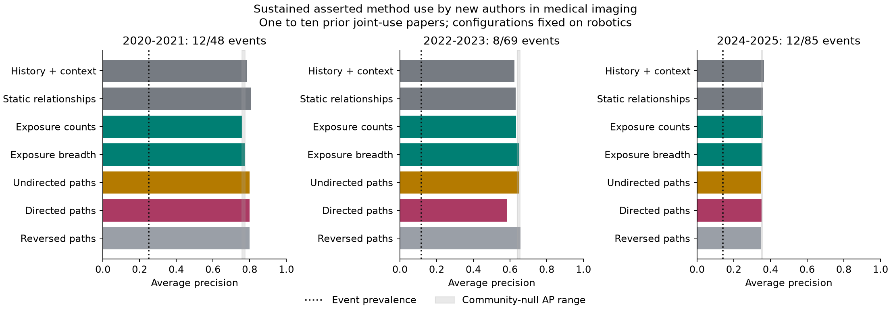
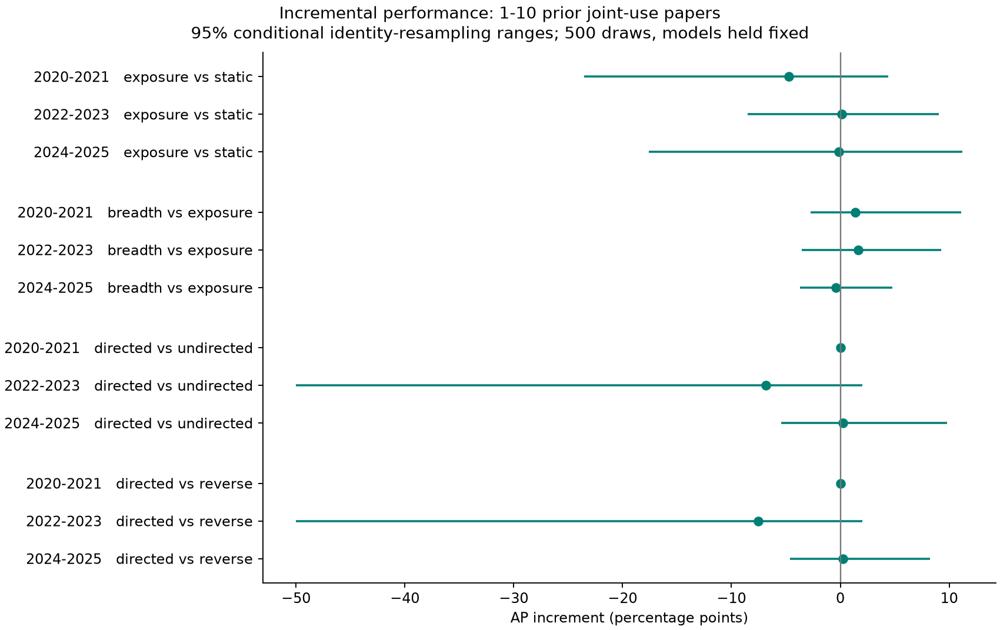

# Cross-community method adoption

Exploratory follow-up, completed 2026-10-15. The local protocol was committed before medical-corpus acquisition (`5a0ec6d`); extraction and model choices were committed before medical outcomes were examined (`36e2719`). The public article is unchanged.

## Result

The tested network features provide no consistent incremental predictive benefit. Citation/collaborator exposure has mixed effects, community breadth improves average precision in two periods but reduces top-20 precision in two, and directed citation paths have no stable advantage over undirected or reversed paths. No mechanism meets the declared practical gate of two additional events per twenty reviews in at least two held-out periods, with positive AP and stable specificity controls.

This pilot supplies evidence against pursuing these particular feature sets on this corpus. Its small event count and measurement limitations leave the broader scientific hypotheses unresolved.

## Data and Test

The new OpenAlex acquisition contains 89,619 records across two medical-imaging topics, with publication dates through 2026-10-14. Preparation retains 86,022 after 2,423 short-abstract exclusions and 1,174 duplicates. No retained medical record matched a development record under the declared overlap rules. The API reported USD 0.0449 for acquisition. Missing references affect 21,533 retained records; 1,754 lack authors.

The ontology contains 23 method families and twelve medical applications. A candidate has at least twenty past method papers and twenty past application papers. The primary analysis considers pairs with one to ten prior asserted joint-use papers. The outcome requires three future pairwise author-disjoint papers, no authors shared with any prior joint-use paper, and qualifying papers across at least two six-month bins within 24 months. This measures corpus-observed asserted co-use and authorship separation. Scientific adoption, independent laboratories and research quality require additional validation.

Robotics supplied development data. Its first training window contained six primary events, below the frozen ten-event threshold, so all models used the declared ridge-logistic fallback, C = 0.2. Each medical origin refitted that fixed specification using only earlier completed robotics and medical outcome windows. All feature sets were evaluated; no held-out model selection followed.

## Held-Out Performance

Average precision (AP), primary candidates:

| Model | 2020-2021 | 2022-2023 | 2024-2025 |
|---|---:|---:|---:|
| Candidates / events | 48 / 12 | 69 / 8 | 85 / 12 |
| History and context | 0.786 | 0.625 | 0.364 |
| + static relationships | 0.806 | 0.632 | 0.361 |
| + exposure counts | 0.759 | 0.633 | 0.359 |
| + exposure breadth | 0.772 | 0.650 | 0.355 |
| + undirected paths | 0.801 | 0.650 | 0.350 |
| + directed paths | 0.801 | 0.582 | 0.353 |
| Reversed-path control | 0.801 | 0.657 | 0.351 |
| Fixed count-burst ranking | 0.506 | 0.266 | 0.249 |

Feature rows are cumulative. Directed and reversed models each include the undirected features. History/context includes volume, growth, corpus-observed age, prior joint use and semantic overlap. The count-burst ranking uses a fixed recent-versus-previous-year binomial score.

Correct events among the twenty highest-ranked candidates:

| Model | 2020-2021 | 2022-2023 | 2024-2025 |
|---|---:|---:|---:|
| History and context | 12 | 7 | 8 |
| + static relationships | 12 | 8 | 7 |
| + exposure counts | 12 | 8 | 7 |
| + exposure breadth | 11 | 8 | 6 |
| + undirected paths | 12 | 8 | 7 |
| + directed paths | 12 | 8 | 6 |
| Reversed-path control | 12 | 8 | 6 |

The 2022-2023 breadth AP increment is 1.67 percentage points over exposure counts. It adds no correct top-20 events. Ten activity-stratified community-label nulls produce AP 0.639-0.656 in that period, which includes the observed breadth result, 0.650. The observed breadth AP also falls within the null range in the other two periods. There is no specific breadth advantage under these controls.

The plotted 2.5th-97.5th percentile ranges use 500 multinomial method/application identity-weight draws with predictions held fixed. They describe sensitivity to this fixed ontology's composition; they do not include model-refitting uncertainty, historical-metadata uncertainty or a population sampling design. All primary comparison ranges contain zero. The 2020-2021 direction comparison has zero AP difference in all 500 draws.

There are 202 primary pair-period rows, 95 distinct method/application pairs and 32 positive pair-period rows involving 26 distinct pairs. Repeated pairs and overlapping method families limit independence. Zero-prior-use risk sets contain 68, 98 and 109 candidates with only one, zero and one events. Their results cannot support a reliable zero-shot discovery claim; AP is undefined in the event-free period.

## Sensitivities and Measurement

Excluding seed authors' past collaborators leaves 10, 8 and 11 primary events. This sensitivity retains the mixed incremental results. The one-new-author-paper endpoint is more frequent, with 20, 28 and 40 events. It uses the unchanged primary rankings; its probabilities are not separately calibrated forecasts. Full endpoint scores and proper scores appear in `results/evaluation.csv`.

The declared descriptive breadth matching finds zero matches in all three periods, among 34, 49 and 65 exposed primary candidates. Single-community candidates number 7, 10 and 12; multi-community candidates number 27, 39 and 53. Exact method/count strata and the fixed covariate-distance caliper provide insufficient overlap. Directed paths are nonzero for every primary candidate, so the negative path result does not arise from universally empty features. No matched breadth effect can be estimated. Observational exposure cannot establish transmission or distinguish influence from homophily here.

Development text review required two rule repairs before the final freeze. The third disjoint sample contains twenty papers and 24 positive method/task matches; one AI reviewer judged 22 supported. The two uncertain matches occur in a multi-topic thesis. This is conditional positive precision, with unmeasured recall, no independent human adjudication and no medical-domain precision estimate. Extracting method and task separately can still connect different contributions within one document. Titles can qualify without a use assertion in the abstract.

A deterministic audit fetched sixteen linked arXiv first-version PDFs. Fourteen yielded bounded abstracts; twelve agreed on plain lexical concepts and nine agreed under the assertion heuristic. These disagreements combine possible text changes, PDF extraction artifacts, formatting and heuristic sensitivity. They are not counts of confirmed revisions. OpenAlex publication dates also differ from some arXiv v1 dates; either source can reflect a different publication event. The audit establishes neither full first-public-date coverage nor historical author/reference identities. The entire backtest remains a current-metadata reconstruction.

The topic filter, English/abstract requirements, fixed method inventory and corpus-restricted communities constrain generalization. Citing a method reference can describe background or a comparator. Most citation and collaborator exposure features count potential exposure rather than verified learning or transfer. The decline in ranking performance in the last period warrants caution; this experiment does not identify its cause.

## Decision and Next Gate

Stop adding graph complexity to this pilot. A further predictive study needs independently adjudicated method/task-use relations and earliest-public-version text, with sufficient events in untouched domains. The development review sheet is `results/human_review.csv`; a separate blinded medical-domain review remains necessary before an additional hypothesis search. A narrower task with reliable use relations would make a useful measurement study even if network features continue to add little.

A local prospective ledger froze 221 candidate pairs across seven models on 2026-10-15 UTC, using the observed corpus with publication dates through 2026-10-14. The entirely later outcome window is 2026-10-16 through 2028-10-15. It has no completed outcomes and no external registration. Future evaluation must exclude already-seen IDs and audit publication/version dates. Reruns preserve this ledger. No monitoring is scheduled.

Validation recomputes all 102 primary saved model/risk/period metric groups, checks 477 feature rows for finite values and eligibility, verifies fifteen raw author/date event witnesses, and checks the prospective ledger's dates and source hashes. These are computational checks. Semantic accuracy and historical identity remain open.

## Sources and Reproduction

- [Protocol](protocol.md), [experiment ledger](ledger.md), [commands](README.md) and [executed analysis notebook](analysis.ipynb).
- OpenAlex [acquisition manifest](results/medical_acquisition.json); local raw data and copyrighted source PDFs remain excluded from Git.
- Ugander et al. (2012), [Structural diversity in social contagion](https://doi.org/10.1073/pnas.1116502109): prior evidence for structural diversity in a different observational setting.
- Aral, Muchnik and Sundararajan (2009), [Distinguishing influence-based contagion from homophily-driven diffusion in dynamic networks](https://pmc.ncbi.nlm.nih.gov/articles/PMC2799846/): identification concerns for observational network exposure.
- arXiv [OAI-PMH documentation](https://info.arxiv.org/help/oa/index.html); individual v1 URLs and PDF hashes are retained in `results/version_audit.json`.
