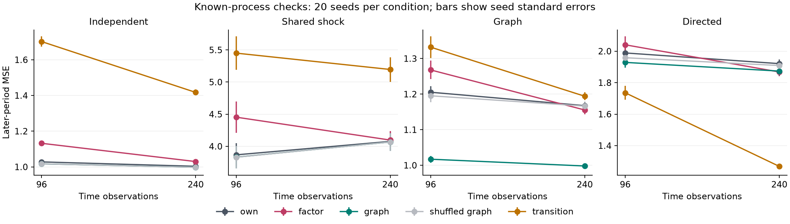
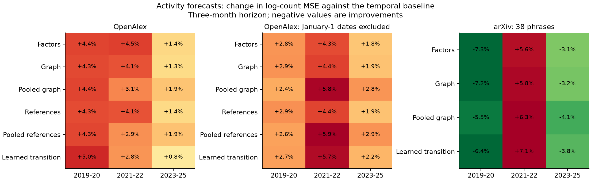
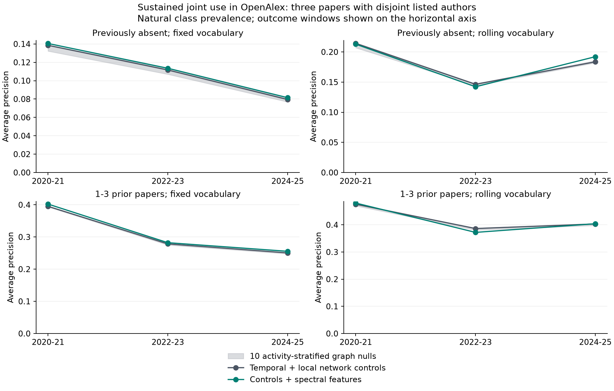
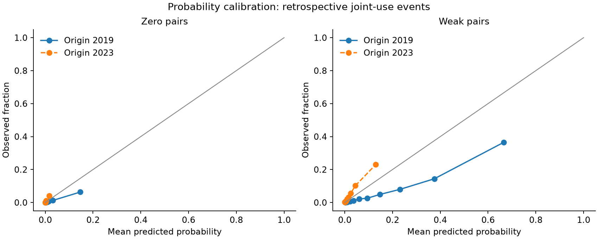

# Does scientific network structure help forecast research activity?

Research memo, 14 October 2026. Branch: `feature/research-directions-2026`.

## Decision

The robotics pilot provides no predictive support for H1, residual activity propagation through the chosen scientific graphs. Temporal forecasts have lower error than every tested graph correction in the primary OpenAlex analysis. The arXiv sensitivity has a small improvement that is also achieved by factor models and randomized graphs.

H2, sustained recombination, has a narrower positive result. Spectral features slightly improve average precision for established terminology in OpenAlex after substantial temporal, semantic and local-network controls. An attribution experiment associates most of that increment with static geometry. The increments are small, their concept-resampling intervals include zero, and they vary when the vocabulary expands. Precision among twenty reviewed candidates has no consistent improvement. The evidence supports further study of sustained adoption; it does not establish a reliable spectral early-warning method or prediction of scientific breakthroughs.

The experiment code, corrected results, initial diagnostic outputs and decision ledger are retained. The public article is unchanged.

## Data and Temporal Design

The primary corpus contains 68,697 English-language OpenAlex records dated 2010-2025, assigned to Reinforcement Learning in Robotics or Robot Manipulation and Learning, with an abstract. Chronological DOI/title-author deduplication and the minimum abstract-length rule retain 66,090 papers. The source sensitivity retains 47,741 arXiv cs.RO papers out of 47,775 downloaded records. Queries, retrieval timestamps and raw-file checksums appear in the [acquisition manifest](results/acquisition_manifest.json).

Both sources reconstruct history using current metadata. arXiv OAI exposes current article metadata; an old submission identifier does not date the abstract text. OpenAlex classifications, authors and references can also have changed since publication. These backtests therefore establish retrospective predictive associations under that reconstruction. Historical metadata availability remains unverified. See the [arXiv documentation](https://info.arxiv.org/help/oa/index.html) and [OpenAlex access documentation](https://help.openalex.org/access/snapshot/).

The source samples overlap: 10,097 retained arXiv titles have an exact normalized-title match in the OpenAlex corpus. Matching is incomplete and can include ambiguous titles. The second source tests sensitivity to coverage and extraction; it supplies limited independent evidence about generalization.

Data-quality constraints matter. OpenAlex has 1,334 retained papers without author IDs and 19,675 without references. January 1 accounts for 14.67% of its dates. An exclusion sensitivity removes these dates while retaining the original vocabulary. Genuine January-1 papers are removed too. arXiv identifiers provide submission months, and normalized author names leave unresolved homonyms and variants.

The frozen vocabulary uses up to 512 adjacent two-word phrases with at least twenty supporting abstracts by the end of 2015. H1 uses the 128 most frequent phrases, with a 64-phrase sensitivity. arXiv has only 38 qualifying phrases. The exploratory rolling analysis relearns the vocabulary and word-context profiles at each origin using only earlier records. This permits later terminology after it has accumulated twenty papers.

All model selection uses earlier complete outcomes. H1 development targets end in December 2018; evaluation origins begin in January 2019. H2 trains on the end-2015 origin, validates on the end-2017 origin, and evaluates end-2019, end-2021 and end-2023 origins with complete 24-month outcomes. Later refits incorporate only completed earlier windows. After the initial results, stronger controls and sensitivities were added as recorded in the [ledger](ledger.md). These follow-ups are exploratory.

## Known-Process Checks

The synthetic study uses 48-node systems, two series lengths and twenty seeds for each of four generating processes: independent autoregression, shared latent shocks, graph-polynomial propagation and directed transfer. Model penalties use earlier validation observations.

At 240 observations, the graph model's mean test MSE is 0.998 for graph-generated propagation, compared with 1.168 for independent autoregression and 1.166 for the shuffled graph. With directed transfer, the learned transition has MSE 1.268 and the undirected graph model has MSE 1.874. These simulations confirm that the comparison can detect advantages when an assumed operator matches the generating process.

Independent and shared-shock simulations also produce small apparent gains over separate univariate fits. Scientific and shuffled graphs perform almost identically in those conditions. Shared parameter estimation can therefore improve prediction without validating the specific graph. A full orthogonal change of basis leaves isotropic ridge predictions equal within a numerical tolerance of 1e-9 in every simulation.

This behavior follows the representation argument in [Shuman et al.](https://arxiv.org/abs/1211.0053) and the need for a fitted temporal law in [Isufi et al.](https://arxiv.org/html/1810.08581v2). Graph coordinates can improve estimation when the dynamical assumptions and regularization are useful. An invertible transform preserves the information in the original observations.

## H1: Residual Activity

The temporal baseline forecasts log(1 + monthly phrase count) using each phrase's lagged levels, recent means, growth, seasonality and past corpus volume. Forecast residuals are generated causally. Corrections compare own residual history, four common factors, graph propagation and a learned ridge transition. Graphs use historical co-occurrence or shared references, cosine weights, seven nearest neighbors and degree normalization. A pooled four-coefficient correction tests whether reducing graph-model complexity helps.

The primary three-month test contains 81 target months, April 2019 through December 2025. Every phrase receives equal weight within a month. The main result is:

| Model | Mean log-count MSE | Change against temporal baseline |
| --- | ---: | ---: |
| Temporal baseline | 0.30930 | 0.00% |
| Common-factor correction | 0.31841 | +2.94% |
| Co-occurrence graph | 0.31795 | +2.79% |
| Shared-reference graph | 0.31797 | +2.80% |
| Pooled co-occurrence graph | 0.31804 | +2.83% |
| Learned transition | 0.31668 | +2.39% |

Positive changes indicate higher error. The co-occurrence graph has higher error in each calendar block: +4.28%, +4.12% and +1.31%. Its average error is effectively equal to the mean of ten activity-stratified label-permuted graphs. The one-month horizon and 64-phrase sensitivity also have higher error, by 2.78% and 2.47%. Removing January-1 records leaves the main graph's error 2.85% higher than its temporal baseline.

In arXiv, the graph improves MSE by 1.78%. The factor model improves it by 1.82%, and the randomized graphs improve it by 1.81% on average. The scientific graph's specific assignment of phrases supplies no observed advantage in that comparison.

Circular time-block resampling illustrates uncertainty conditional on the observed series. For the primary graph's percentage error change, six-month blocks give a 95% resampling range of -0.32% to +5.69%; twelve-month blocks give +0.25% to +5.07%. Block choice affects the range. The test spans three calendar regimes and offers limited independent replication. No claim that all scientific activity lacks network propagation follows.

An exploratory representation diagnostic freezes graph and PCA bases at the end of 2018 and measures later cross-lag covariance. After four common factors are removed, the graph basis places 1.73% of the three-month cross-lag matrix's squared energy on its diagonal in OpenAlex. Permuted bases give 1.37%-1.92%. The statistic describes matrix alignment; it provides no additional forecast validation. It supplies little evidence that independent graph modes organize the residual dynamics.

Count deviance after inverse transformation is retained as a secondary point-forecast diagnostic. Inverting a log-scale conditional mean does not estimate a calibrated count distribution. The pilot does not test a negative-binomial observation model or every possible graph-temporal architecture.

## H2: Sustained Joint Use

A pair qualifies when both phrases have sufficient historical support and zero or one to three earlier joint-use papers. Pairs sharing a token are excluded. An event requires at least three future joint-use papers over 24 months, observations in at least two six-month bins, and a set of three papers with pairwise disjoint nonempty listed-author sets. An exact triple-existence test determines the author condition.

This endpoint measures repeated language use with an authorship constraint. It does not verify independent laboratories, conceptual novelty, practical adoption or scientific value. The repeated-publication sensitivity omits the author condition.

The comparison model includes phrase support, recent counts, growth, age, degree, neighborhood growth, pair counts and age, context-word similarity, common neighbors, Adamic-Adar, preferential attachment and local-network changes. The spectral addition contains heat-kernel similarities and distances at three scales and their two-year changes. Logistic ridge and bounded boosted trees compete on historical validation AP. Each scientific and randomized feature set receives the same model-selection opportunity.

For the frozen OpenAlex vocabulary:

| Outcome window | Prior joint papers | Candidates / events | Baseline AP | Spectral AP | Top-20 precision, baseline / spectral |
| --- | --- | ---: | ---: | ---: | ---: |
| 2020-2021 | 0 | 63,886 / 550 | 0.1385 | 0.1405 | 40% / 50% |
| 2022-2023 | 0 | 53,464 / 300 | 0.1116 | 0.1135 | 40% / 35% |
| 2024-2025 | 0 | 46,420 / 264 | 0.0795 | 0.0815 | 10% / 10% |
| 2020-2021 | 1-3 | 45,002 / 3,175 | 0.3951 | 0.4022 | 100% / 95% |
| 2022-2023 | 1-3 | 46,866 / 2,222 | 0.2784 | 0.2822 | 60% / 65% |
| 2024-2025 | 1-3 | 46,436 / 2,179 | 0.2504 | 0.2554 | 65% / 60% |

Average precision is evaluated at natural prevalence. The weak-pair increments are 0.71, 0.38 and 0.50 percentage points. They exceed all ten randomized-graph AP values in their respective fixed-vocabulary windows. This is a small within-corpus alignment result. The randomizations preserve topology and broad activity strata, while individual phrase degree and semantic relationships can change. They do not establish causal propagation or control every popularity effect.

Pairs share phrases and papers. Multinomial vertex resampling, with pair weight equal to the product of its two phrase weights, gives weak-pair increment ranges of [-0.11, 1.45], [-0.54, 1.37] and [-0.38, 1.45] percentage points. All include zero. These are sensitivity ranges conditional on fitted predictions, with no guarantee of population coverage; they omit model-refit and metadata uncertainty.

### What Contributes to the Gain

An exploratory ablation isolates the consistently positive fixed-vocabulary weak-pair cohort. All feature sets receive the same historical model-selection opportunities:

| Feature set | AP, 2020-2021 | AP, 2022-2023 | AP, 2024-2025 |
| --- | ---: | ---: | ---: |
| Popularity, history and context | 0.3869 | 0.2569 | 0.2354 |
| Plus static local network features | 0.3969 | 0.2688 | 0.2564 |
| Plus local network changes | 0.3951 | 0.2784 | 0.2504 |
| Plus static spectral features | 0.4009 | 0.2826 | 0.2559 |
| Plus spectral changes alone | 0.3960 | 0.2789 | 0.2509 |
| Plus static and changing spectral features | 0.4022 | 0.2822 | 0.2554 |

The last three rows all start with the complete local-network-and-change controls in row three. Static heat-kernel features recover most of the small spectral increment. Spectral changes alone add 0.09, 0.05 and 0.05 AP percentage points. Ordinary neighborhood changes help in one period and hurt in two relative to static local network features. In the latest window, static local network features also outperform the full spectral model. The pilot therefore gives little support for a repeatable dynamic precursor beyond structural similarity and temporal controls.

### Vocabulary and Meaning

The frozen vocabulary becomes progressively less representative of later robotics terminology. Its latest arXiv zero-pair set contains ten candidates and no events. Average precision is undefined there. Treating that cell as a measured failure or a perfect prediction would be incorrect.

The rolling vocabulary restores substantial candidate sets. In OpenAlex, its weak-pair AP increments are +0.44, -1.41 and +0.09 percentage points; zero-pair increments are -0.13, -0.41 and +0.85. In arXiv, rolling weak-pair increments are -1.89, +0.65 and +0.06; zero-pair increments are -0.71, +0.17 and -0.23. The spectral addition has no stable advantage across these populations and periods. Changing vocabulary changes the scientific question as well as its difficulty, so AP levels across the two populations are not a matched model comparison.

Inspection finds URL fragments, generic descriptions and inflection variants among the phrases. A declared lexical screen removes obvious cases from already fitted rankings. For the latest OpenAlex rolling zero-pair cohort, the increment falls to 0.26 percentage points. The screen leaves modest fixed-vocabulary gains and mixed rolling results. Its rules are published in [lexical_rules.json](results/lexical_rules.json). Remaining phrases still require scientific interpretation.

One ranked example is "robot manipulation" with "deep learning": the selected OpenAlex abstracts contain no earlier joint-use paper by the end-2019 origin and thirteen in the next two years. That means joint use within this filtered corpus. [Levine et al. (2016)](https://jmlr.org/papers/v17/15-522.html) had already reported deep convolutional policies for real-world robot manipulation tasks. A phrase-pair event cannot establish the historical invention of the underlying idea.

The result is adjacent to established scientific link prediction, including [Science4Cast](https://www.nature.com/articles/s42256-023-00735-0), and to [Maillart et al.'s conceptual-diffusion preprint](https://arxiv.org/html/2606.03919v1). No priority claim follows from this pilot. The [literature review](../literature-review.md) records the scope and access limits of the source review.

### Calibration and Lead Time

Ranking and event probability have different validation requirements. The fixed-vocabulary models overpredict events in the earliest evaluation window. A past-window logistic recalibrator improves some later scores and worsens others. For OpenAlex rolling weak pairs, spectral Brier score changes from 0.0809 to 0.0894 in 2022-2023 and from 0.1027 to 0.1004 in 2024-2025. Calibration drift remains unresolved.

These models rank candidates before their complete outcome windows. The study does not measure an advantage in detection lead time over a dedicated sequential burst detector at a matched false-alarm rate. It also does not measure scientific usefulness through blinded expert review. Those claims remain open.

## Research Direction

Further spectral complexity has a weak justification at this stage. The next useful hypothesis is about transfer of identifiable methods across research communities:

> Among method-application pairs matched on age, volume and initial joint use, does prior exposure across distinct author and reference communities predict durable use by additional groups?

This asks about an observable adoption process. A directed exposure operator has a substantive role: it records which communities have encountered a method. The current undirected phrase graph primarily describes accumulated joint language use. The new design would need a comparison with common factors, local exposure counts and an estimated directed transition before attributing an advantage to spectral coordinates.

The next pilot should use a small, expert-reviewed method/application vocabulary with explicit synonym resolution; retain first-public text versions and preprint/journal links; and audit author-group identities. Reserve a new corpus before inspecting its outcomes. Evaluate repeated adoption in groups absent from the pair's initial papers, complete 24-month outcomes, precision at a declared review budget, calibration and lead time at a fixed false-alarm budget. Register a timestamped prospective list after those choices are fixed.

A practical gate can be agreed in advance, such as two additional scientifically validated adoptions per twenty reviews across multiple held-out periods. This is a proposed utility threshold. Current results do not establish that performance. Degree-constrained rewiring, incidence randomization, hypergraphs, text embeddings, impact prediction and a full external benchmark reproduction remain untested. Their costs should follow evidence that the basic outcome and graph have scientific meaning.

## Validation and Access

Twenty-two tests pass, including causal feature boundaries, earliest-record deduplication, graph cutoffs, exact author-triple logic, weighted AP with ties, numerical deviance and preservation of an accepted corpus after a failed fetch. The core-only environment also passes its eleven tests, with the optional research test module skipped. Baseline/full-spectral AP and Brier values were recomputed, 96 ranked-pair cases were checked directly against tokenized abstracts and author witnesses, and forecast tables passed horizon, uniqueness and finite-value checks. The 59 validation checks also verify input checksums and reproduce the shared ablation rows. All four figures were visually inspected. The [validation receipt](results/validation.json) defines this scope.

The [runner](run_campaign.py) regenerates the corrected analyses; the [README](README.md) gives commands and snapshot limitations. Raw records and full prediction arrays are local and gitignored. Credential scans found no API key in research files or cached OpenAlex responses. The study is suitable for sharing as an exploratory research record with these caveats. It is insufficient evidence for a general spectral emergence claim.
