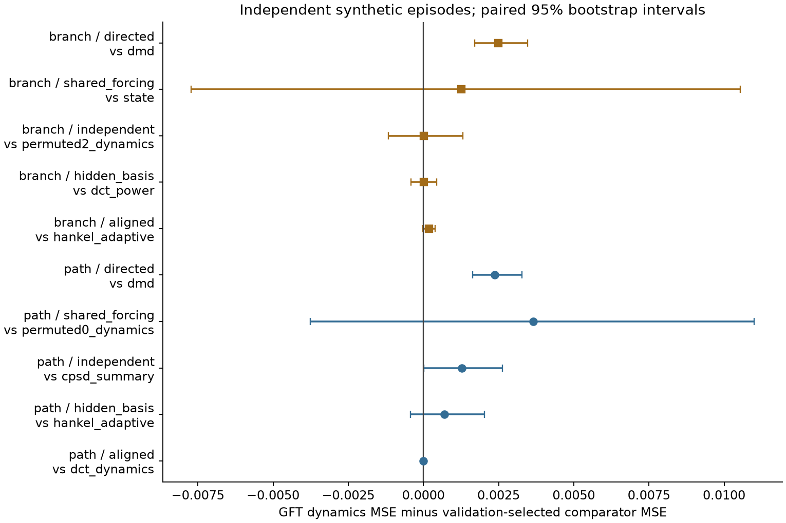
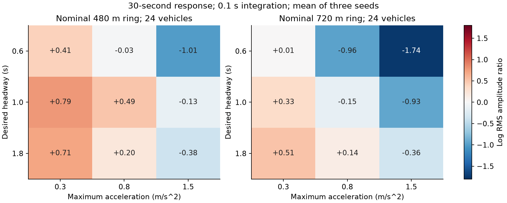
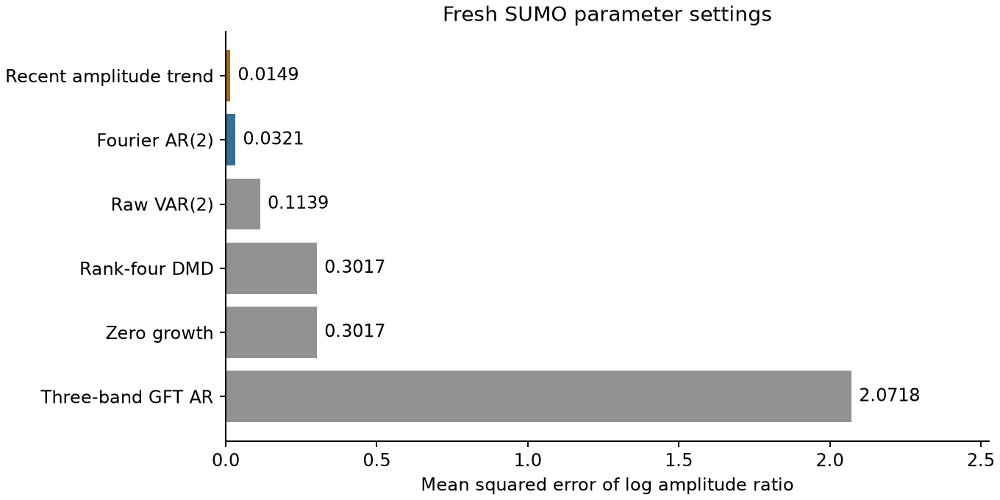
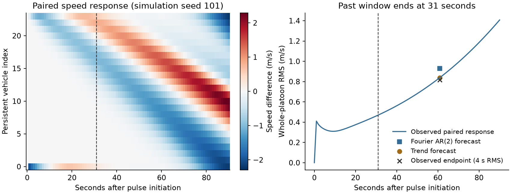
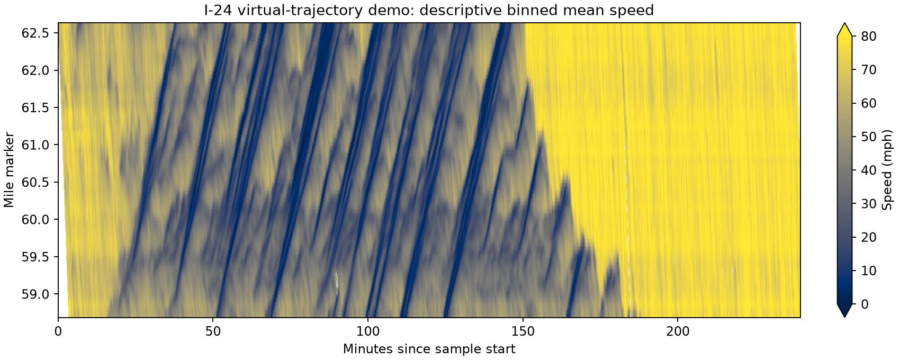

# Traffic spectral research: first experimental findings

Date: 2026-10-15. Branch: `feature/traffic-spectral-amplification`.

## Assessment

These studies have not established a forecasting benefit specific to GFT. We established measurement controls, found a baseline specification problem, tested a phase-aware extension on fresh physical simulation settings, and identified an unresolved availability problem in a public derived dataset. Empirical Traffic H1 and H2 remain open.

The evidence supports a more specific next question: can spatial mode structure add information after current amplitude and its recent growth are accounted for, under heterogeneous or irregular traffic dynamics? A regular homogeneous ring provides an equivalence control for GFT and ordinary Fourier analysis.

## Numerical controls

The [initial protocol](protocol.md) covers five mechanisms on each of two geometries. Each case uses 320 training episodes, 96 validation episodes, and 192 reserved evaluation episodes. One origin per episode avoids overlapping windows. The first run records 180 model/case comparisons and 34,560 predictions. These are artificial linear systems with specified forcing and measurement noise.

On the uniform path, GFT and DCT band features agree numerically. The graph-aligned branched system initially gives GFT power-plus-dynamics MSE 0.001862 against 0.002077 for the validation-selected cross-spectral summary: a 10.4% reduction. Its paired descriptive 95% bootstrap interval for the loss difference is [-0.000379, -0.000060]. This system explicitly generates dynamics in the chosen graph basis, so the comparison is an oracle-aligned positive control.

Inspection also found that pooled innovation covariance penalized DMD/AR forecasts when forcing varied across episodes. The feature regressions already observed each episode's variability. We recorded a [follow-up design](forcing-followup.md), added past-window covariance estimates, and evaluated fresh seeds. This second run records 220 comparisons and 42,240 predictions.

The fresh branched/aligned result gives GFT features MSE 0.002191 against 0.002005 for the validation-selected adaptive Hankel model. The difference is +0.000186, with interval [-0.000019, +0.000391]. The earlier feature advantage therefore does not establish superiority over this stronger comparator. Adaptive GFT band AR gives 0.001994, close to 0.002005; its interval also spans zero. On the uniform path, its basis is equivalent to DCT band AR.

In the directed controls, learned evolution forecasts substantially outperform the graph-band features. Their evolution matrices have eigenvalue magnitude 0.92 and operator norm approximately 1.069. Finite-time amplification can occur despite asymptotically decaying eigenmodes. This illustrates why a spatial Laplacian spectrum or an evolution eigenvalue alone cannot determine finite-horizon disturbance growth.

The [saved scores](results/adaptive/scores.csv), [paired differences](results/adaptive/paired.csv), and [operator diagnostics](results/adaptive/diagnostics.csv) contain every case. Ten selected generating systems support conditional numerical findings; their bootstrap intervals supply no universal traffic significance claim. Current-state features already include graph-local differences, so the contrast tests added spectral information over those local controls.

## Physical traffic responses

We used SUMO 1.28.0's existing IDM implementation for 24 vehicles on a homogeneous ring. The [protocol](sumo-protocol.md) varies road length, acceleration, and desired headway. Each pulse run is paired with an otherwise identical unperturbed run. The response is their same-vehicle speed difference. This counterfactual is available in simulation and would require another measurement design in observational data.

The sweep contains 216 completed simulator runs, or 108 paired responses. Validation recorded zero collisions and teleports, complete vehicle retention, and zero response before the pulse. The first sequential-insertion attempt failed retention and was repaired before endpoint analysis; its metadata remain preserved.

The physical endpoint distinguishes growth and decay. At a 0.1-second integration step, the 480 m ring with desired headway 1.0 s and acceleration 0.3 m/s^2 has a mean 30-second log amplitude ratio of about +0.79. The 720 m ring with headway 0.6 s and acceleration 1.5 m/s^2 gives about -1.74. These are outcomes of the specified simulator settings, with three initialization seeds per cell.

GFT and matched ordinary real-Fourier band AR forecasts differ by at most 4.92e-14. The ring supplies the expected equivalence check. Three-band scalar AR has MSE 2.5905; the recent amplitude trend gives 0.0223. Averaging across this designed grid describes these scenarios, rather than real-road performance.

Comparing integration steps 0.2 s and 0.1 s gives a mean absolute endpoint difference of 0.0147 and maximum 0.0398 in log amplitude ratio. Three of 54 paired step comparisons change growth/decay sign in a near-zero cell. Continuous endpoints and numerical-step sensitivity are necessary near that boundary. Integration-step refinement is distinct from coarsening the observed sensor sampling interval.

## Phase-aware follow-up

Scalar lag-one persistence mixes propagation phase with amplitude decay. For a rotating two-component mode, the pooled lag-one coefficient is `r cos(theta)`, although the norm evolves by `r`. We tested a [fixed complex Fourier AR(2) model](phase-followup.md) and a matched-history raw-coordinate VAR(2) on 32 fresh parameter settings. Each setting was simulated at two integration steps, for another 128 simulator runs.

| Fixed forecast | MSE of log amplitude ratio |
| --- | ---: |
| Recent amplitude trend | 0.01486 |
| Fourier AR(2) | 0.03206 |
| Raw-coordinate VAR(2) | 0.11387 |
| Rank-four DMD | 0.30167 |
| Zero growth | 0.30173 |
| Three-band GFT AR | 2.07177 |

Losses average the integration steps within each setting and then weight settings equally. Fourier AR(2) improves on the raw VAR(2) comparator, with paired loss difference -0.08181 and descriptive 95% interval [-0.13677, -0.03592]. It still loses to the recent amplitude trend: difference +0.01720, interval [+0.00773, +0.02789]. Intervals resample whole parameter settings.

This supports investigating phase-aware dynamics and spatial translation constraints in this simulator. It provides no advantage over the strongest simple forecast tested here. Raw VAR has more parameters, and per-frequency penalty scaling differs from global raw-coordinate scaling. The comparison tests a package of constraints under short histories; a separate ablation would be needed to assign the gain to each choice. The first two physical studies deliberately use a regular homogeneous ring and a known isolated pulse. Their favorable signal quality and restricted forcing differ substantially from a real freeway.

All fresh physical settings pass collision, teleport, and pre-pulse checks. Integration-step refinement changes the endpoint by at most 0.01223 and produces no sign disagreements. A full rerun is recorded separately in the ledger.

## Public-data audit

The [version-pinned public sample](https://github.com/I24-MOTION/wave-analysis/blob/dbe85b4ad5fbb592840036fa4f5edde2d427f28a/demo_data/vt_lane_1.csv) contains 1,137,588 rows and 2,857 virtual trajectory IDs. Positive within-trajectory increments are one second. It spans relative seconds 30-14,400 and approximately mile markers 58.69-62.60. IDs describe generated virtual trajectories and cannot establish independent vehicles or days.

There are 1,943 rows with missing position and speed, all at the corresponding trajectory's final timestamp, plus 29 negative speed values. No duplicate vehicle/time keys were found. The [profile](results/data_audit/profile.json) retains these counts. Missing endpoints are excluded explicitly from the descriptive field; raw inputs remain unchanged. This figure averages derived trajectory observations in 10-second by 0.05-mile bins, with a color scale capped at 0 and 80 mph. It is not a direct detector field or a traffic-density estimate.

The [inspected VT-tools implementation](https://github.com/I24-MOTION/VT_tools/blob/e51e3e98124ab2ef6aa2f2d478f64f82f445aa96/ASM.py) uses symmetric temporal support, with a default 36-second window that admits observations up to 18 seconds after a target timestamp. The exact demo-generation parameters and full processing delay remain unverified. This static source check establishes a prospective-validity risk; it does not establish an exact leakage duration for the demo. Third-party code was inspected without execution.

The [virtual-trajectory paper](https://arxiv.org/html/2311.10888v1) describes the processed product. The later [wave-identification study](https://arxiv.org/html/2409.00326v2) supplies additional prior art and a possible physical label extractor. Targeted review covered methodology, data, and processing appendices. Its graph represents wave-boundary events. These sources do not verify this sample's full online availability chain. Raw causal fields, regenerated past-only preprocessing, or a verified availability delay are required for a strict forecast test. No real-data forecasting metric is reported.

## Next study and stopping rule

Keep current amplitude, its recent growth, and forcing proxies as strong controls. The next physical study should vary ongoing external forcing independently of response parameters and include heterogeneous drivers or an irregular road/lane graph. First define an outcome that remains valid when disturbances overlap or exit the observed road. Freeze one horizon and one primary contrast before acquiring reserved outcomes.

Use matched temporal dynamics in GFT, ordinary spatial, PCA, and learned-operator representations. Preserve phase or cross-mode coupling where the evolution law requires it. Apply identical observation masks and compare against local graph features and graph nulls. A sparse-sensor advantage must survive comparison with ordinary spatial interpolation and training-fitted state estimation.

Proceed to an empirical claim only after causal input availability and independent recording days are verified. If the graph representation continues to match ordinary transforms or lose to amplitude history under the relevant conditions, report that limit. The current evidence supplies no basis for revising the public article into a positive traffic-prediction claim.
