# Manuscript development record

The [draft](manuscript.md) reports controlled simulations and retrospective trajectory measurement checks. Publication priority and empirical instability/forecast validation remain open. The public HTML article is unchanged.

## Evidence map

| Claim | Evidence |
| --- | --- |
| Increasing long-band share accompanies both growth and decay | `results/spectral/case_summary.csv`, primary grid dt=0.1 and follow-up dt=0.05; `manuscript_support.json`. |
| GFT power equals ordinary Fourier power on the cycle | Analytical eigenspace equivalence, rotation tests, and `results/spectral/validation.json`. |
| Density integrates to taper-weighted mean-square fluctuation | Unit tests and direct full-FFT validation, `results/spectral/independent_validation.json`. |
| Larger pulses depart from quadratic response scaling | `results/spectral_forcing/scaling.csv` and `window_power.csv`; fine step 0.05 s. |
| Smaller pulses approach quadratic early scaling | `results/spectral_small_pulse/scaling.csv`; fine step 0.025 s. This is an adaptive follow-up, recorded after the larger-pulse outcomes. |
| No established best-baseline forecasting improvement | Earlier `results/phase` forecast comparison; the present study adds no new forecast score. |
| Coupled equilibrium dynamics predict small-amplitude responses | `results/mechanism/full_response_validation.csv`, `phase_comparison.csv`, and `independent_validation.json`; all 72 primary cases pass the fixed 5% criterion. |
| Growing power can occur in a linearly decaying harmonic | `results/harmonics/exponents.csv`, `growth.csv`, and `autonomous_comparison.csv`; q=3 is seeded through a q=1 initial disturbance. |
| Heterogeneous graph bands lose important coupling | `results/heterogeneity/responses.csv`, `error_summary.csv`, and `coupling.csv`; graph weights and band dimensions fixed before outcomes. |
| Empirical spectra depend on temporal baseline and spatial support | `results/ngsim/profiles.json` and `temporal_centering.csv`; I-80's failed primary grid is retained. |
| Whole-window consistency improves one specified low-noise contrast | `results/observation_window/rejection_summary.csv`; headway 1 s, full mask, fine step, harmonic rejection 52.25% versus 6.75% for adjacent innovations. Direct controls remain near the specified noise-null rate. |
| Incomplete sensing introduces conditional recovery and alias limits | `sampling_diagnostics.json` and both observation studies' complete tables; uniform-8 target abstains, omitted harmonics remain a risk. |
| Empirical resolution and trace exclusion alter modal allocation | `results/ngsim_resolution/eligibility.csv`, `spectra.csv`, and `quality_exclusions.json`; 20 of 32 configurations eligible, with no imputation. |
| Operator uncertainty inflates autonomous-model rejection | `results/uncertainty/operator_error/` and `learned_operator/`; model misspecification and unstructured estimates have direct-control failures. |
| A correct restricted model retains conditional calibration | `results/uncertainty/physics_fit/`; 32 additional paired responses with independent phases/noise, correct IDM structure, and exact equilibrium. |
| Reference uncertainty can dominate the test | `results/uncertainty/reference_noise/`; exact-linear nulls and physical response sensitivity are separate. Correct covariance or fitted nuisance terms controls the specified null, with loss of weak-signal sensitivity. |
| Unknown acceleration input prevents unique stability identification | `results/uncertainty/forcing/ambiguity.csv`; growing and forced-decaying linearizations share equilibrium and complete modal trajectories. |
| Baseline and exclusion sensitivity persists beyond the first two blocks | `results/ngsim_expansion/`; 906,559 new rows, fixed nonoverlapping blocks, one failed exclusion field, no independent-day claim. |

`summarize_spectra.py` exports the exact values used in the prose. All powers describe paired speed differences with the uniform component separated. Seed ranges are descriptive. Primary grid cases comprise 18 parameter settings with three placement seeds, and the follow-up adds 32 settings. Numerical replicas are dependent.

## Supporting figures

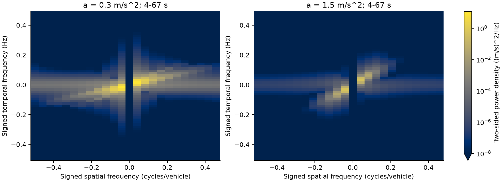

Signed Fourier companion, 4-67 s. The undirected GFT groups conjugate modes and loses this directional information. Temporal frequency uses the DFT sign convention; a synthetic traveling-wave test checks the convention. Spatial coordinates are vehicle indices, with no road-frame speed inference.

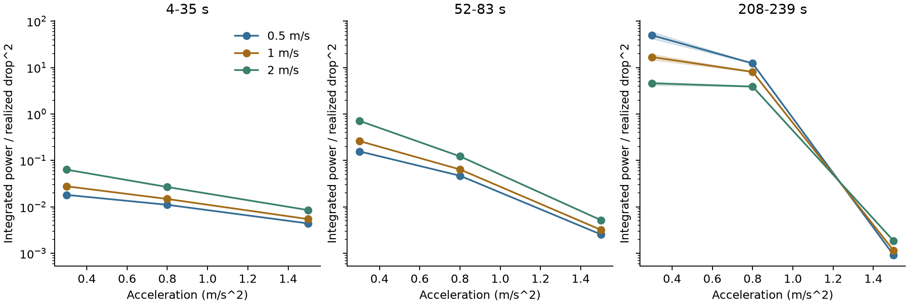

Integrated all-mode nonuniform power divided by realized drop squared. Lines are three-seed means and shaded regions are ranges, at the finer integration step. The changing ordering across windows is retained.

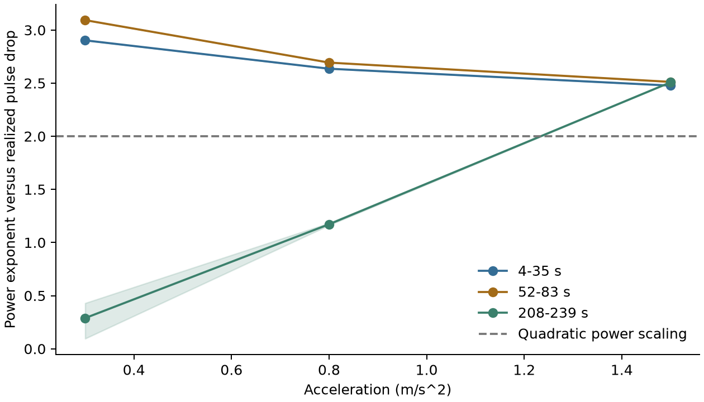

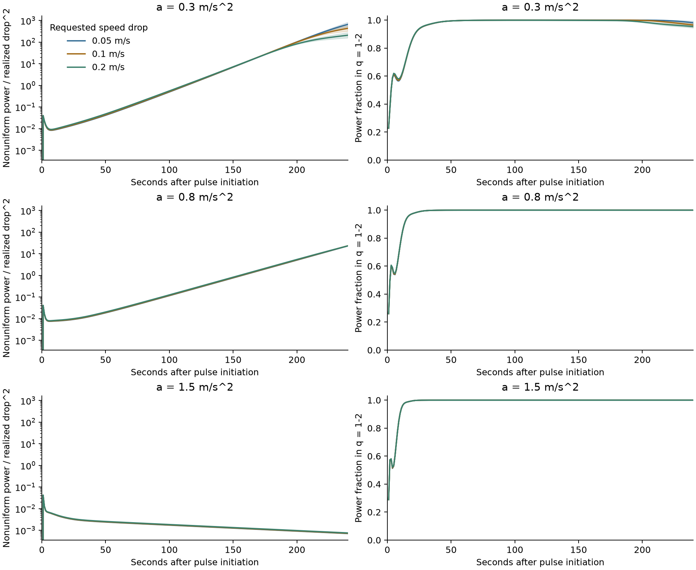

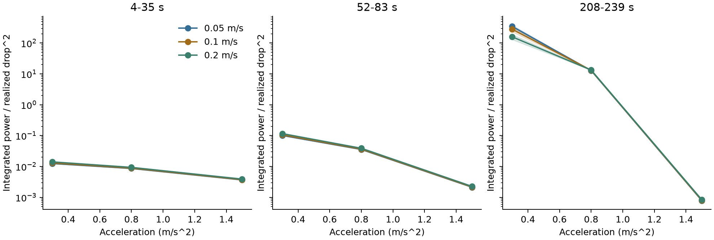

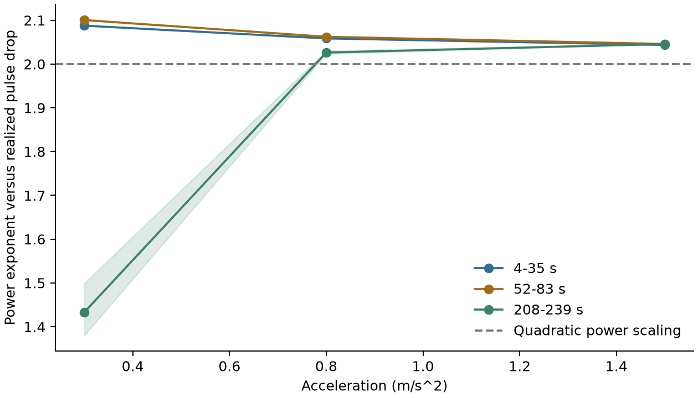

## Prior-art boundaries

The focused [amplification review](../traffic-amplification-review.md) and preceding [novelty review](../traffic-novelty-review.md) retain reading depths and access gaps. Loukas and Perraudin establish joint graph-temporal spectra, including traffic applications. Takada et al. directly study a non-neural GFT congestion precursor. Traffic spectral envelopes and dynamical-mode methods are close precedents. The present result may be a replication, a controlled limitation study, or part of a later methodological contribution. Priority is unresolved.

The 2014 spectral-envelope paper's publisher abstract, introduction, and section excerpts were accessed; its complete methods were unavailable. No exact ESPE implementation or superiority claim is made. The Takada paper and selected author code were inspected in the preceding audit. Avila and Mezic's main text was inspected, with no independent supplement/code audit. The IDM original is cited for model background; no proof or exact SUMO equivalence to continuous IDM is asserted. Bibliographic formatting and completeness require review before submission.

## Mechanism and Empirical Figures

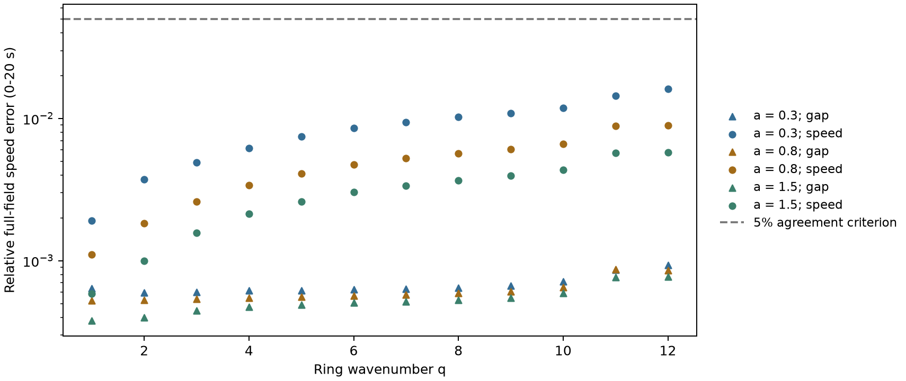

Full physical speed-response errors, including generated off-mode components. The older `response_errors.png` shows selected-mode errors only. The full-field table implements the registered physical-response agreement criterion.

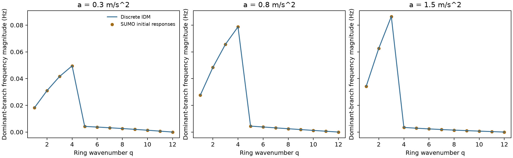

Frequency magnitudes of the dominant two-state branch, with theoretical and initial-response estimates. The dominant branch can change with q; the jumps reflect branch selection and supply no resonance claim. A magnitude comparison does not preserve a signed propagation interpretation.

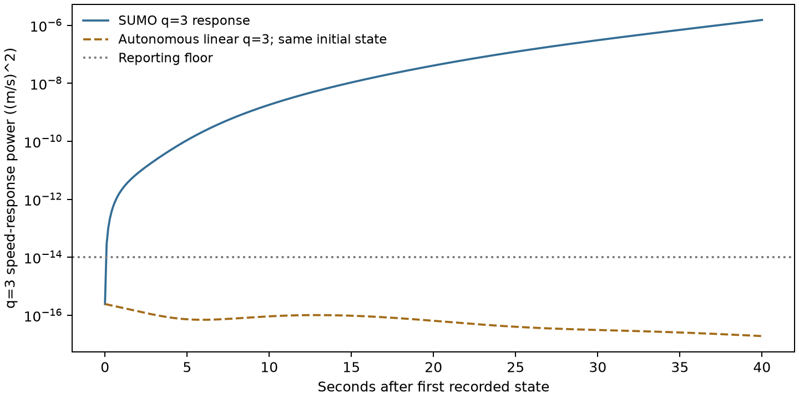

Acceleration 0.3, initial q=1 amplitude 0.2 m/s, step 0.01 s. The autonomous q=3 prediction uses the same observed initial q=3 gap/speed state. Its small magnitude shows that an initially seeded harmonic plus autonomous linear transients cannot explain the measured growth. In the growing acceleration settings, its late predicted power is less than 1.1e-9 of observed power across the tested amplitudes. That ratio is a deterministic model diagnostic, without a sensor-noise interpretation.

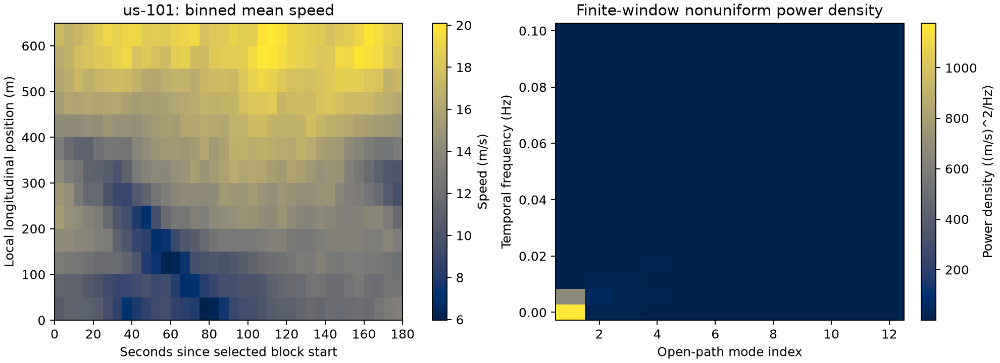

Mean trajectory-observation speeds over a complete 650 m strip. Temporal and spatial binning, lane aggregation, processed coordinates, and baseline choice affect the spectrum.

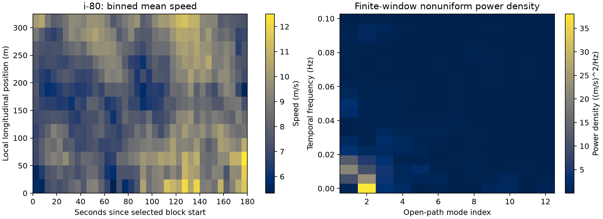

Registered 25 m sensitivity over a complete 325 m strip. Its 50 m primary field fails the eight-bin requirement. This is a different spatial support and recording, with no direct cross-site instability inference.

## Completed Extensions

- M1: 192 initial-condition responses and six controls. Analytic/block/finite-difference checks, empirical phase/growth, and full physical-response validation pass the stated criterion.
- H1: 48 heterogeneous responses and eight controls. Weighted bands improve two selected heterogeneous patterns, match uniform bands in the alternating pattern, and remain much less accurate than full known dynamics. The weighted construction does not consistently reduce the Frobenius coupling metric.
- H2: 24 harmonic responses and six controls. Power orders near 2/4/6 and a matched autonomous comparison support nonlinear harmonic excitation. Two below-floor late rows, one at each step, are excluded from reported growth. The initial unmasked ratio table is preserved as `growth_before_floor.csv`.
- D1: two new official FHWA recording blocks, 439,065 rows, 41.48 MB including metadata. Hashes and exact server-side row counts verify complete selected queries. Source timestamps and use metadata are retained. There are 75 large position/speed mismatch increments across both blocks; raw observations are retained. TGSIM's filtered-field metadata remain a separate candidate audit, without a TGSIM spectral result.

All three new simulation sweeps were repeated in full. Seven original scenario/response/operator/exponent/coupling files are byte-identical; the receipt lists each file. Independent physical-coordinate band projections and real FFT calculations verify the extension tables. The empirical centering sensitivity uses an independent explicit-Hann FFT integration check. The first sensitivity attempt encountered a pandas read-only NumPy view; copying before spatial demeaning repaired the analysis without changing data selection or any input.

The new [mechanism protocol](mechanism-protocol.md), [heterogeneity/harmonic protocol](heterogeneity-followup.md), [collection selection](ngsim-collection-followup.md), and [empirical sensitivity plan](empirical-sensitivity-followup.md) retain what was known before each stage. The final simulator source acquisition receipt was obtained during validation; it is a pinned implementation check, without a retrospective pre-evaluation acquisition claim.

## Observation and Resolution Follow-up

The [observation protocol](observation-protocol.md) was recorded before its new physical responses and empirical resolution outcomes. It supplies 56 interventions and four controls. Exact full observations separate the specified direct-mode and fundamental-driven histories using a fixed relative-residual check. The noisy adjacent-innovation test has limited sensitivity at every specified nonzero noise level.

The [adaptive follow-up](window-consistency-followup.md) records a whole-window autonomous fit and four new phases before their collection. Another 56 interventions and four controls supply its physical responses. At headway 1 s and the lowest nonzero noise, the fine-step full-mask whole-window test rejects 52.25% of harmonic histories across 400 synthetic noise draws, with phase-specific frequencies 48-57%. Direct-gap and direct-speed controls give 5.5% and 5.75%. Sparse masks and stronger noise reduce detection. These are conditional model-consistency results, with known operator/covariance and exact reference. No causal warning, unknown-operator identification, empirical sensor performance, or population classifier is established.

The stronger whole-window control exposed a simulator-clock error. SUMO rounds a requested 0.0125 s step to 0.013 s, making the original eight-step recording interval 0.104 s. All three affected studies were archived with `_timing_audit` suffixes and rerun at 0.025/0.01 s. Their raw arrays remain preserved. The collector now checks the effective simulator step and every recording timestamp. The [clock correction](timing-correction.md) and `results/observation_window/clock_validation.json` retain the evidence. Harmonic figures and growth values are recalculated; the growing-harmonic/decaying-linear-mode finding persists. Earlier bitwise reproduction alone had verified the same incorrect time-base assumption.

Independent covariance validation then detected an inconsistent SVD cutoff in the rank-deficient uniform-12 dictionary. The [sampling correction](sampling-correction.md) sets a common relative cutoff, verifies exact nuisance annihilation, and preserves previous tables under `analysis_revision/`. Existing physical arrays were reanalyzed, with separate corrected source archives. Complete-mask conclusions are unchanged.

All corrected affected physical sweeps have complete repeat runs. Observation tables reproduce byte for byte after the same analysis repair. Independent physical-coordinate transitions, sensor covariances, and generalized least squares verify 15,660 observation comparisons, with maximum absolute discrepancy 8.15e-10. The independent exact-linear whole-window noise-null checks span 4.14-6.36% rejection. Noise repetitions supply no new physical environments.

The fixed-support empirical study compares 32 configurations and retains 20 eligible grids. I-80 fails 1/2 s coverage; no cells are imputed. Four US-101 and 41 I-80 vehicle traces meet the specified kinematic exclusion rule. At I-80's 5 s/25 m sensitivity, exclusion changes centered first-two-mode share from 0.6469 to 0.5549. It changes the population, without establishing that every flagged trace is erroneous. Independent NumPy cell aggregation, an explicit cosine basis, and Hann FFT integration reproduce 40 spectra within 1.43e-14.

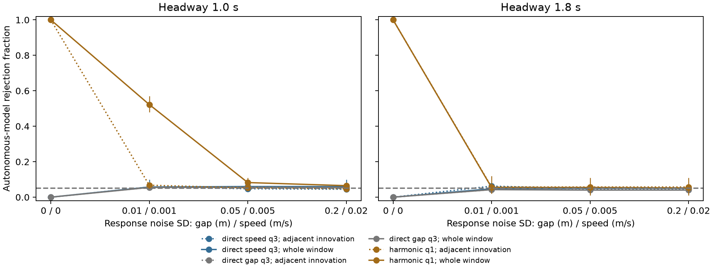

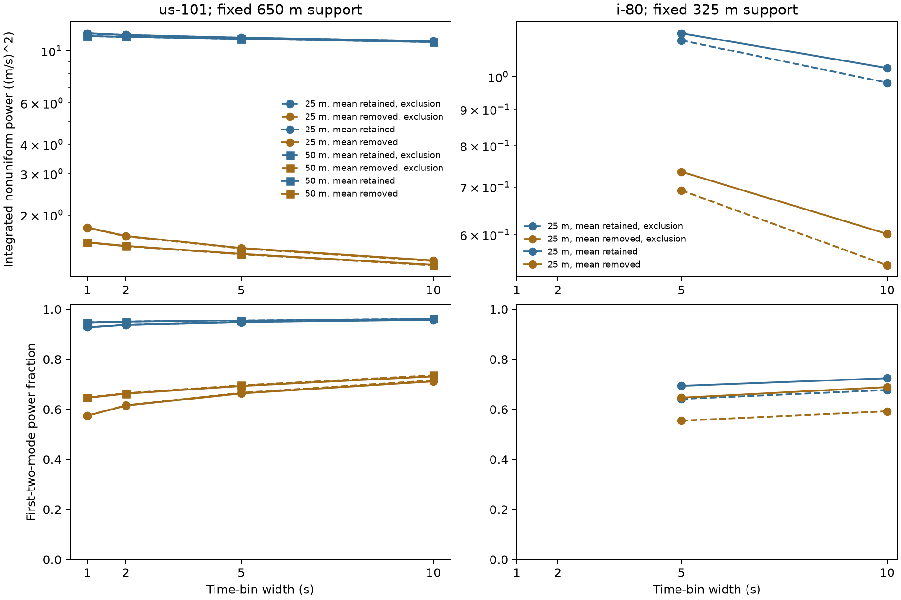

## Operator, Reference, and Forcing Validation

The [uncertainty protocol](uncertainty-protocol.md) records U1-U4 before their outcomes. A fresh SUMO cohort contains 64 paired responses plus four controls. Parameter perturbations, independently trained OLS/TLS/noise-corrected operators, reference covariance, and correlated measurement noise retain complete tables. Model estimation uses only the original direct-response training cohort, with separate direct-response calibration. The new cohort supplies evaluation. Phase changes in this homogeneous ring do not sample independent roads or driver populations.

Unstructured operator errors produce high direct-speed plug-in rejection even where growth-sign estimation is correct. Empirical calibration of a pooled gap/speed mixture lowers average rejection and leaves different conditional rates. At the highest noise, 29 of 320 operator cases abstain. None is silently converted to a negative detection. The published noise-aware methods are established baselines: targeted sections 2.1-2.5 of Dawson et al. and the augmented-projection discussion of Hemati et al. were checked; their numerical examples were not replicated. Method references and access limits appear in the protocol.

The adaptive [restricted-fit protocol](physics-fit-followup.md) follows these outcomes and precedes 32 more paired responses plus two controls. Correct IDM structure and exact equilibrium determine headway; acceleration is fitted by full-history variable projection. At headway 1 s and low noise, mean operator error is 0.023%, compared with 1.38% for TLS using the same training-noise realizations. Restricted plug-in direct-speed rejection is 5.68%, versus 72.13% for TLS. Direct-calibrated harmonic rejection is 52.14%, versus 9.23% for TLS. Correct-model information is essential to this contrast. The known baseline/equilibrium and noise covariance are still strong assumptions.

Exact-linear reference controls separate observation misspecification from nonlinear physical effects. At headway 1 s and step 0.01, ignoring an independent K=1 reference error gives 81.18% false rejection; correct covariance gives 5%. Correct joint GLS and nuisance fitting give 4.16-5.90% across the complete registered exact-linear null set. Fitting nuisance offset/drift can absorb weak physical signal: the low-noise, exact-reference harmonic case drops from 49% rejection to 8.25%. These quantities are conditional Monte Carlo frequencies.

Continuous DOP853 integrates 32 full IDM responses with a refined companion for each. Maximum refined speed-response difference is 8.92e-13; SUMO agreement over 20 s is within 0.642% at the coarser step and 0.256% at the finer step. An exact linear construction has q=3 intrinsic rates +0.01146/-0.08122 s^-1 under two acceleration parameters with the same equilibrium. A prescribed acceleration-only input below 0.00987 m/s^2 makes their complete modal trajectories agree within 1.18e-15 relative norm. This is an unknown-input identifiability counterexample, without an observed-road or unrestricted nonlinear equivalence claim.

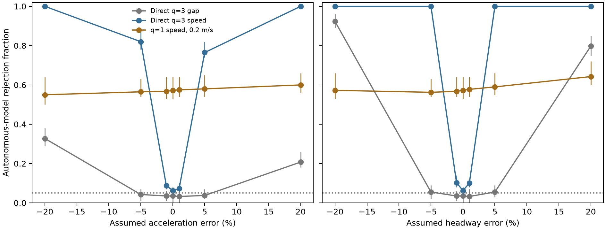

Headway 1 s, fine step, lowest noise. Whiskers span phase-specific Monte Carlo frequencies. Gap and speed direct controls have different response amplitudes/units and different rejection rates. Parameter changes are one at a time at the measured equilibrium.

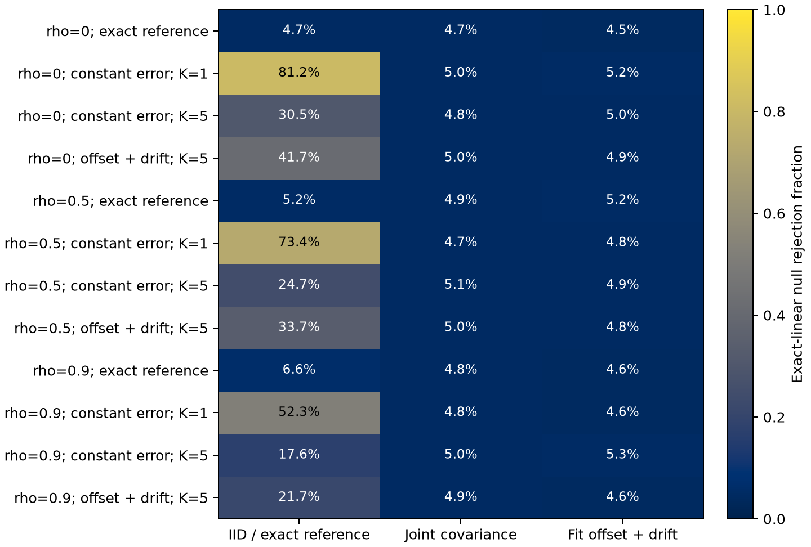

Each cell is an exact-autonomous noise-null rejection rate over 5,000 histories. Known covariance or nuisance models supply the corrected comparisons. No empirical noise-covariance estimation is included.

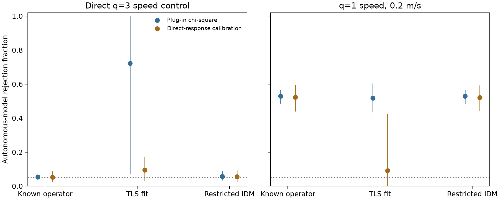

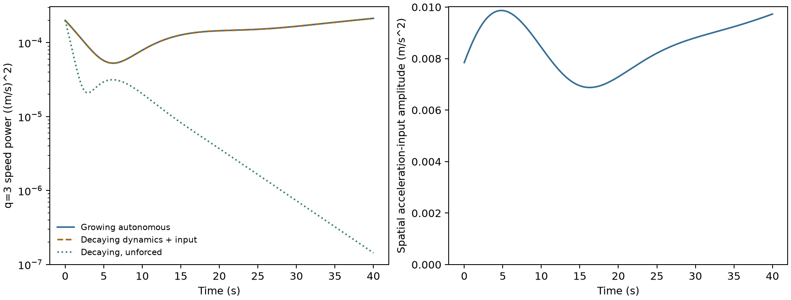

All new physical collections and five numerical analysis stages were repeated with separate raw/output directories. Fourteen numerical CSV tables are byte-identical; the two physical scenario tables also match. Independent projection/GLS/estimator/aggregation checks cover the recorded scope in `results/uncertainty/validation.json`: all first-phase parameter/reference rows, all unstructured fitted matrices, and first/last training-noise fits for diagnostic replay. Restricted scalar fitting is independently checked using full physical-coordinate projection and a bracketed scalar optimizer. These are 7,187 numerical comparisons, with maximum error divided by max(1, absolute expected value) below 8.43e-13. Full repeated execution and sampled independent replay are distinct checks.

One repeat attempt failed because the optional physical directory was relative while the receipt expected an absolute path. Resolving the path before creating its relative provenance entry repaired execution. No cohort, parameters, or outcome calculations changed. Original frozen source content remains intact. Later lint/closure binding changes preserve the numerical tables.

## Additional Empirical Blocks

The [NGSIM expansion plan](ngsim-expansion-followup.md) fixed four new cohorts before acquisition. They add 906,559 rows and 87,104,551 bytes, with independent server counts and accepted file hashes. Combined with the original two blocks, the six acquired cohorts contain 1,345,624 rows before spatial selection. No additional independent recording day is established.

All four new unfiltered 5 s/25 m fixed-support grids pass. The I-80 block at offset 240 s has a first-two-mode share that increases after temporal centering, 0.5703 to 0.6366, unlike the initial blocks' decrease. The final I-80 trace-exclusion sensitivity removes 184 of 539 vehicles and 94,230 of 243,524 rows, leaving one missing cell. It is ineligible and has no imputed spectrum. Original trajectories remain unchanged. An independent NumPy binning/cosine/FFT calculation verifies every eligible new field and reproduces the exclusion/coverage decisions.

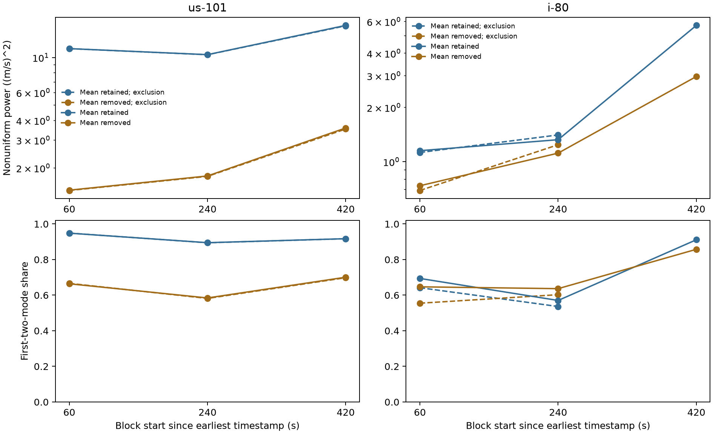

## Next Experiments

1. Test the restricted fit when the equilibrium itself is estimated and the generating driver law differs from IDM. The present fit benefits from the correct law and exact equilibrium, and those assumptions now define the next transfer test. Keep operator-growth classification separate from model-consistency rejection.
2. Constrain and estimate continuing inputs using additional observations or controlled interventions. Explicit sinusoidal forcing and the exact ambiguity control are complete. The original localized pulse's detailed command/recovery decomposition remains open.
3. Expand heterogeneity to reserved driver patterns and irregular road or lane structure. Compare complete eigenspaces, ordinary transforms, local statistics, and learned dynamics under identical observations and fitting budgets. The current four patterns are development cases.
4. Estimate noise covariance and preprocessing effects using separate calibration data. Specified AR/reference covariance is complete; empirical noise floors and causal processing remain unresolved. Keep integration-step refinement separate from observation sampling.
5. Establish an empirical input/label contract with independent days and causal or explicitly retrospective preprocessing. Define a physically measurable disturbance outcome before fitting predictors. The short NGSIM blocks and I-24 derived sample do not establish prospective validity.

The immediate milestone is experiment 1. The controlled harmonic finding now has operator/reference and input-ambiguity boundaries. A restricted correct-model fit can retain useful conditional consistency checks, while unstructured learning and uncertain references expose failure modes. Novelty remains to be checked against nonlinear traffic-wave and system-identification literature before a publication contribution is claimed.
