# Spectral concentration and nonlinear mode growth in traffic disturbances

Working manuscript, 15 October 2026. Controlled simulations and retrospective measurement examples; empirical forecasting validity and publication priority remain open.

## Abstract

Spectral representations separate traffic disturbances by spatial scale. Their relation to instability requires controls for absolute amplitude, nonlinear response, and measurement baseline. We analyze paired Intelligent Driver Model simulations and finite-window graph-temporal spectra. Long-wavelength power share increased in all 54 primary grid responses, although absolute nonuniform power increased in 27 and decreased in 27. Coupled gap-speed dynamics predict small-amplitude responses, while fundamental-mode disturbances generate harmonics whose powers scale approximately as the fourth and sixth powers of initial amplitude. Third-harmonic power can grow while its equilibrium linear mode decays. Whole-window autonomous-model checks detect some harmonic excitation under specified low noise. Operator error and uncertain references can inflate rejection. With the correct IDM form and exact equilibrium, a restricted fit keeps direct-control rejection near the nominal level. Reference fitting reduces false rejections and weak-signal sensitivity. An acceleration-only input also makes a decaying linearized system reproduce a growing autonomous trajectory, establishing an unknown-input ambiguity. Six official NGSIM blocks provide 1,345,624 observations for retrospective measurement checks. Temporal baseline, binning, and trace exclusions alter measured powers and modal shares. These findings distinguish spectral concentration, observed power growth, and equilibrium modal stability. Graph-specific forecasting benefit, real-road instability identification, and publication novelty remain unestablished.

## 1. Introduction

A localized traffic slowdown excites disturbances across several spatial scales. A spectral representation can follow how those scales evolve even when individual vehicle traces contain overlapping responses. The useful question is whether a spectral change identifies a physical property that survives controls for disturbance size, temporal evolution, and the chosen spatial representation.

Traffic oscillations already have an extensive spectral literature. Zhao, Nie, and Zhang [1] use spectral envelopes and cross-spectral information to characterize oscillation frequencies and their spatial contributions. Avila and Mezic [2] identify growing and decaying traffic modes with data-driven dynamical analysis. Takada, Azuma, and Banno [3] study congestion warnings based directly on graph Fourier coefficients. Joint graph-temporal spectral analysis also has an established mathematical formulation [4]. These precedents motivate a controlled study of what spectral measurements can identify under a specified disturbance experiment. A transform followed by spectral integration supplies no independent claim of methodological novelty.

We examine three questions. Does increasing long-wavelength concentration distinguish an amplifying disturbance from an attenuating one? Which modes carry absolute growth or decay? How does the response change when pulse strength varies at fixed traffic parameters? Forecast accuracy is a secondary consideration. A useful result can describe a physical response or identify a limitation of a proposed spectral indicator.

The core thesis is that wavelength selection, observed amplitude evolution, and equilibrium modal stability require separate measurements. We test those distinctions in paired simulations with a known intervention and an observable unperturbed control. The regular vehicle cycle provides a representation control: its graph Fourier eigenspaces coincide with ordinary Fourier subspaces. Subsequent initial-condition experiments identify the linear response and test nonlinear harmonic generation. Retrospective trajectory fields examine how baseline and coverage choices affect the measured spectrum.

## 2. Methods

### 2.1 Paired traffic simulations

We use SUMO/libsumo 1.28.0 with its implementation of the Intelligent Driver Model (IDM), whose original formulation is described by Treiber, Hennecke, and Helbing [5]. Each simulation contains 24 identical vehicles on a single-lane ring. Vehicle length is 5 m, minimum gap is 2 m, desired speed is 30 m/s, comfortable deceleration is 2 m/s^2, and emergency deceleration is 9 m/s^2. Within a parameter setting, vehicle parameters are shared. Initial positions have a seeded common cyclic offset and independent perturbations of at most 0.02 m. The seeds therefore represent small placement differences; they do not sample driver heterogeneity or independent roads.

After a 60 s warmup, vehicle 0 receives a one-second slowdown command. External speed control is then released. Each intervention is paired with a control simulation having identical initialization and parameters. We record same-ID speeds at one-second intervals and define

\[
x_i(t)=v_i^{\mathrm{pulse}}(t)-v_i^{\mathrm{control}}(t).
\]

The paired difference isolates the consequence of the imposed intervention within the simulator. Such a counterfactual is available directly in simulation. Observational traffic measurements require a separate baseline definition.

The existing grid contains nominal ring lengths of 480 and 720 m, desired headways of 0.6, 1.0, and 1.8 s, and acceleration parameters of 0.3, 0.8, and 1.5 m/s^2. Three placement seeds and two integration steps, 0.2 and 0.1 s, produce 108 paired responses. Primary descriptive comparisons use the 54 responses at 0.1 s. Netconvert reports an actual length of 479.92 m for the nominal 480 m ring. Exact generated lengths are retained in the scenario tables.

A separate follow-up contains 32 previously generated continuous parameter settings, each at integration steps of 0.1 and 0.05 s. We analyze all 64 responses and use the 32 finer-step responses for primary summaries. These settings were created for an earlier forecasting comparison. Their aggregate outcomes were known before the present descriptive protocol was recorded.

### 2.2 Spatial mean and grouped mode power

The graph connects neighboring vehicle indices on an undirected, equally weighted cycle. Its combinatorial Laplacian is a spatial analysis operator; it does not encode the directed car-following evolution law. At each time, we separate the uniform response,

\[
m(t)=\frac{1}{N}\sum_i x_i(t),\qquad
r_i(t)=x_i(t)-m(t),\qquad N=24.
\]

For ring wavenumber \(q\), let \(P_q\) project onto the complete Laplacian eigenspace. Define

\[
E_q(t)=\frac{\|P_q r(t)\|^2}{N},\qquad
V(t)=\sum_{q=1}^{12} E_q(t),\qquad
s_q(t)=\frac{E_q(t)}{V(t)}.
\]

The exact decomposition is

\[
\frac{1}{N}\sum_i x_i(t)^2=m(t)^2+V(t).
\]

Here, power denotes a quadratic speed-response measure in (m/s)^2. It is distinct from physical kinetic energy. The mean response remains separate throughout the spatial analysis. Shares are undefined when nonuniform power is at or below the numerical reporting floor of 10^-12 (m/s)^2.

Wavenumbers 1-11 each have two real dimensions; wavenumber 12 has one. Grouping complete eigenspaces makes power invariant to the arbitrary eigenvector orientation within repeated eigenvalues. On this cycle, grouped GFT power equals grouped ordinary spatial FFT power. The wavelength associated with q is 24/q vehicles. Changing intervehicle distances prevent a fixed conversion into a road-distance wavelength during the response.

We fix three bands before spectral inspection: long, q=1-2; intermediate, q=3-6; and short, q=7-12. Their wavelengths are respectively 12-24, 4-8, and approximately 2-3.43 vehicles. A uniformly oriented nonuniform signal has expected band fractions of 4/23, 8/23, and 11/23 by subspace dimension. These fractions supply a geometric reference, without a statistical significance test.

### 2.3 Finite-window temporal density and integration

We compute a one-sided Hann periodogram for each real GFT coordinate, using density scaling [6], then sum coordinates within each eigenspace and divide by N. The primary analysis uses no temporal detrending after spatial demeaning. It therefore retains temporally slow and constant modal contributions. These are finite-window spectra of a transient paired response. We make no joint-stationarity assumption or stationary covariance interpretation [4].

For a window starting at a, with taper w and frequency spacing \(\Delta f\), the integrated modal power satisfies

\[
\overline E_q(a)
=\Delta f\sum_j S_q(f_j;a)
=\frac{\sum_{t=a}^{a+31}w(t-a)^2 E_q(t)}{\sum_{u=0}^{31}w(u)^2}.
\]

The graph spectrum is discrete. We sum spatial mode masses and integrate temporal frequency bins with their spacing. Summing all nonuniform modes recovers the corresponding taper-weighted time-domain mean-square fluctuation. The additional description is its allocation across spatial scales and temporal frequencies.

Primary early and late windows are 4-35 s and 52-83 s after pulse initiation. For powers above the reporting floor in both windows, define the finite-window amplitude growth statistic

\[
g_q=\frac{1}{2(48\ \mathrm{s})}
\log\left[\frac{\overline E_q(52)}{\overline E_q(4)}\right].
\]

This statistic describes the observed paired response. An intrinsic modal damping rate or an evolution eigenvalue requires further model identification. The 32 s windows give a frequency-bin spacing of 0.03125 Hz; they cannot resolve fine spectral linewidths. Sensitivities use 24- and 40-sample windows centered at the same times and constant temporal detrending. The latter changes the measured quantity to temporally centered fluctuation power.

### 2.4 Pulse-strength experiments

We fix nominal length at 480 m and headway at 1 s, with acceleration parameters 0.3, 0.8, and 1.5 m/s^2. The first sweep requests drops of 0.5, 1, and 2 m/s. It uses three placement seeds and integration steps of 0.1 and 0.05 s. The paired same-vehicle drop at the pulse endpoint defines realized strength D. Responses are observed through 240 s, and power is normalized by D^2.

After inspecting departures from quadratic scaling, we recorded a small-pulse follow-up with requested drops of 0.05, 0.1, and 0.2 m/s and integration steps of 0.05 and 0.025 s. Other parameters and measurements remain fixed. Each sweep uses 18 controls shared across 54 interventions, or 72 simulator runs. Together they supply 108 paired responses. Four additional runs verify that the extended recording code preserves a previously saved default control/intervention pair exactly.

For each acceleration, seed, integration step, and window, we fit a descriptive three-point relation between log integrated nonuniform power and log realized drop. Its slope is the power exponent. Linear response with an amplitude-scaled intervention would give exponent 2 and overlapping D^2-normalized power curves. We report seed means and ranges, without population confidence intervals. A final window, 208-239 s, measures later evolution. This sequential design is exploratory; it has no external preregistration.

### 2.5 Coupled mode dynamics and initial-condition experiments

Let \(s_i\) be the bumper-to-bumper gap and let vehicle \(i+1\) lead vehicle \(i\). At equilibrium, all vehicles have common speed \(v^*\), and individual gaps satisfy

\[
s_i^*=\frac{2+\tau_i v^*}{\sqrt{1-(v^*/30)^4}},\qquad
\sum_i(s_i^*+5)=C.
\]

For homogeneous vehicles, write the derivatives of IDM acceleration with respect to gap, own speed, and leader speed as \(F_s\), \(F_v\), and \(F_l\). For \(k=2\pi q/N\), the continuous gap-speed mode block is

\[
B_q=\begin{pmatrix}0&e^{ik}-1\\F_s&F_v+F_l e^{ik}\end{pmatrix}.
\]

Its eigenvalues describe equilibrium linear evolution. The two gap-speed branches can both contribute to a measured speed mode. We also derive the semi-implicit discrete block corresponding to one IDM iteration and SUMO's position update. The pinned source [7] uses one IDM iteration at the integration steps tested here. Analytic derivatives are checked against centered finite differences; block dynamics are checked against a full physical-coordinate Jacobian.

Single-mode initial conditions perturb either gaps or speeds at q=1,...,12, with primary amplitude 0.01 m or m/s. The amplitude-0.1 sensitivity uses q=1,3,6,12. Three acceleration parameters and steps 0.05/0.025 s give 192 interventions and six controls. No external slowdown command is applied. We record gaps and speeds every 0.1 s through 40 s. Prediction starts at the first post-insertion observed state, with complete two-state dynamics. The registered primary agreement criterion is less than 5% relative full-field speed-response error over the first 20 s in the 72 finer-step, amplitude-0.01 cases. This is a conditional response check under known model parameters.

After that check, four headway patterns test heterogeneity: common headway, alternating 0.7/1.3 s, two contiguous 12-vehicle blocks at those headways, and one fixed centered random pattern bounded by the same limits. Mean headway remains 1 s. Individual equilibrium gaps adjust while common equilibrium speed remains fixed. Six zero-mean broadband speed disturbances per pattern, each RMS 0.01 m/s, and two steps give 48 interventions and eight controls.

We compare the full known linear operator with band-diagonal approximations in uniform-cycle GFT, a symmetric weighted-cycle GFT, and a fixed random orthonormal basis. Edge weights are proportional to sqrt(F_s,i F_s,i+1). Spatial band dimensions are fixed at 1,4,8,11 across bases. Both gap and speed coordinates remain within each band; the uniform-gap coordinate is excluded because total ring length is fixed. Cross-band coupling is measured through the off-band squared Frobenius norm after nondimensionalizing gaps by mean equilibrium gap and speeds by equilibrium speed. Twenty fixed random bases supply a descriptive reference. Coupling magnitude depends on this normalization and need not order finite-horizon response errors.

A further 24 initial-condition interventions test harmonics. We impose q=1 speed amplitudes 0.05,0.1,0.2,0.4 m/s at three acceleration settings and steps 0.025/0.01 s. Powers at q=1,2,3 are averaged over the half-open windows 10-20 s and 20-30 s after the first recorded sample. Descriptive log-power slopes test amplitude orders two, four, and six. A 10^-14 (m/s)^2 reporting floor determines eligibility. These experiments contain six additional controls. Simulator-clock checks verify the effective integration step and every 0.1 s recording interval.

### 2.6 Retrospective trajectory collection

We obtain two fixed 180 s blocks from the official NGSIM trajectory API [8], at locations US-101 and I-80. Each block starts 60 s after that location's earliest timestamp. Selection uses metadata and coverage before inspecting its speeds. Separate server-side counts verify complete query retrieval. The combined acquisition, including metadata, is 41.48 MB. Inputs retain query URLs, timestamps, checksums, and the metadata-reported license identifier CC_30_BY_SA. Raw observations remain unchanged.

Mean observed speeds are binned across all lanes at 5 s by 50 m, with 25 and 100 m spatial sensitivities. We select the longest contiguous strip observed in all 36 time bins, requiring at least eight spatial bins. Selection uses occupancy counts and no interpolation. An open-path Laplacian avoids imposing periodic road boundaries; its GFT power is checked against ordinary cosine-transform power. We spatially demean each field and compare periodograms with and without constant temporal detrending on identical spatial support. These are descriptive fields of processed video trajectories. Their bins have no flow or density interpretation, and their processing availability has not been established for causal forecasting.

A subsequent resolution study fixes supports at [0,650) m for US-101 and [0,325) m for I-80. It compares 1,2,5,10 s temporal bins and 25/50 m spatial bins wherever the support divides exactly. Every cell must contain observations, and at least eight spatial bins are required. Support is held fixed after the initial study; missing cells receive no interpolation. A secondary quality sensitivity excludes an entire selected vehicle trace if any within-trace position/speed discrepancy exceeds 5 m/s. This rule follows the inspected acquisition audit and precedes filtered spectra. Unfiltered fields remain primary. Exclusion changes the observed vehicle population and has no established ground-truth cleaning interpretation.

After these outcomes, a recorded expansion acquires two additional nonoverlapping 180 s blocks per location, starting 240 and 420 s after the location's earliest timestamp. The first block starts at 60 s. The expansion keeps the spatial supports, 5 s/25 m bins, trace rule, and complete-cell requirement fixed. Exact server counts, bounded acquisition, and source hashes are retained. These six blocks span the same recording contexts; they supply no independent-day replication.

### 2.7 Autonomous consistency under observation limits

Two further studies test whether a q=3 response follows known autonomous gap-speed dynamics. Both use acceleration 0.3 m/s^2, headways 1.0/1.8 s, and steps 0.025/0.01 s. Direct q=3 gap or speed disturbances have amplitude 0.02 m or m/s; a q=1 speed disturbance of 0.2 m/s supplies harmonic excitation. A q=11 speed disturbance of 0.2 m/s tests spatial aliasing at headway 1 s. The equilibrium q=3 mode decays at headway 1 s and grows at headway 1.8 s. Each study contains 56 interventions and four controls. Initial phases are 0,pi/4,pi/2,3pi/4 in the first study and pi/8,3pi/8,5pi/8,7pi/8 in the adaptive follow-up.

Observation masks retain all 24 vehicles, every second vehicle, every third vehicle, or 12 fixed irregular vehicles. Each sampled vehicle supplies own speed and leader gap, with an exact paired reference. We compare a constant-plus-q=3 reconstruction with a declared dictionary containing the constant and sine/cosine pairs q=1,2,3,11. Target identifiability is checked independently of nuisance-mode rank. Identifiability in this dictionary assumes its spatial support; unmodeled harmonics can still alias. Rank-deficient inversions and nullspace calculations share a fixed relative singular-value cutoff of 10^-10. Nonidentifiable q=3 coefficients receive an abstention.

Independent Gaussian response-level errors have gap/speed standard deviations (0,0), (0.01,0.001), (0.05,0.005), or (0.2,0.02), in m and m/s. These are specified synthetic scenarios without empirical sensor calibration. Spatial least squares propagates their covariance to the four real gap-speed coordinates. Gaps and speeds are nondimensionalized by their equilibrium values.

The first diagnostic compares adjacent states at 0.5 s spacing over 10-30 s with the known transition M. For state covariance Sigma, its residual covariance is Sigma + M Sigma M^T. A 95th-percentile threshold is calibrated with 2,000 pure measurement-noise histories, preserving dependence between adjacent residuals. After inspecting its limited noisy sensitivity, the follow-up fits an entire autonomous trajectory. Its design has block rows I,M,...,M^40; covariance-weighted least squares estimates the unknown initial four-state vector. Under the exact linear Gaussian null, the whitened residual sum of squares has 160 degrees of freedom. We calibrate its threshold with 2,000 histories and independently check the chi-square reference.

The follow-up's phases and noise seeds are fixed before its collection. Evaluation uses 100 noise histories per physical response, disjoint from calibration. These repetitions measure conditional detection frequency, without sampling new traffic environments. Noiseless diagnostics use a fixed 1% relative residual criterion and the numerical power floor. Both studies are retrospective known-operator consistency checks. They estimate no warning lead time and identify no unknown traffic operator. Protocols and subsequent numerical corrections are recorded in the development notes.

### 2.8 Operator and reference uncertainty

A further 64 paired responses use phases pi/16 plus 0,pi/4,pi/2,3pi/4, the same two headways and integration steps, direct q=3 gap/speed disturbances, and q=1 speed amplitudes 0.2/0.4 m/s. Four controls supply the references. Parameter sensitivity changes assumed acceleration or headway by -20,-5,-1,0,+1,+5,+20 percent, one at a time, while evaluating derivatives at the measured equilibrium. The three previously specified nonzero noise levels remain fixed.

Operator estimation uses only the first observation study's direct responses at 0-10 s. Separate direct responses in the second study at 10-30 s calibrate a pooled empirical cutoff. The new phases supply evaluation. We fit complex two-state transitions by ordinary least squares, noise-whitened total least squares, and known-noise corrected moments. These are established noise-aware system-identification comparisons [9,10]. Each configuration has 20 independent training-noise realizations, 40 noise draws per calibration response, and 100 per evaluation response. Non-positive corrected Gram matrices and numerically unidentified history designs receive abstentions. The pooled cutoff describes the specified gap/speed control mixture and provides no conditional-calibration guarantee.

After inspecting those outcomes, an adaptive study adds 32 paired responses and two controls at phases 3pi/32 plus the same four phase increments, using the 0.01 s step. A restricted IDM fit infers headway from the exact equilibrium identity and estimates acceleration within [0.1,2] m/s^2. Covariance-weighted variable projection fits the unknown initial state of each training history. Training and calibration cohorts stay fixed; new noise streams and physical phases supply evaluation. The restriction assumes the correct IDM form, its other parameters, and exact equilibrium information. It is a separate information condition from unrestricted operator learning.

Reference/noise sensitivities use temporal AR(1) correlations 0,0.5,0.9. A reference estimated from K independent measurements introduces a time-shared four-state error with covariance Sigma/K; K is 1 or 5. A further scenario adds a linear reference error whose time coordinate spans [-1,1]. Joint covariance is the temporal covariance tensor the state covariance. We compare an iid/exact-reference analysis, generalized least squares with the correct joint covariance, and fitting four-state constant/linear nuisance terms with the correct AR covariance. Verified residual dimensions are 160 or 152. Exact autonomous linear histories with 5,000 noise draws per scenario check false-rejection calibration independently of nonlinear SUMO controls. Noise properties remain specified, without real-sensor estimation.

### 2.9 Continuous integration and forcing controls

An independent SciPy DOP853 integration of the full 48-state continuous IDM equations supplies 32 responses at the new phases and both headways. Initial conditions are direct q=3 speed amplitude 0.02 m/s or q=1 speed amplitude 0.2 m/s. Two additional conditions start at equilibrium under spatial q=3 or q=1 acceleration inputs, of amplitude 0.002 or 0.02 m/s^2, multiplied by cos(2 pi 0.05 t). Primary tolerances are 10^-8/10^-10 with maximum step 0.1 s; refinement uses 10^-10/10^-12 and 0.05 s. SUMO comparisons sample the continuous solution at actual simulator timestamps over the first 20 s, retaining insertion/update differences. A known-input linear companion subtracts the exact q=3 forced response before the autonomous check.

A separate constructive control uses q=3 linearizations at headway 1.8 s and acceleration 0.3 or 1.5 m/s^2. They share the equilibrium and gap-kinematics row. For a trajectory z of the growing model, the prescribed input u(t)=(B_growing-B_decaying)z(t) acts only in acceleration. Independent integration of the decaying system under that input tests equality of the complete modal trajectories. This construction concerns linearized systems with unknown external input; it supplies no equivalence claim for unrestricted nonlinear traffic.

## 3. Results

### 3.1 Long-wavelength concentration occurs during both growth and decay

Across the 54 primary grid responses, long-band share increased in every response. Late-window shares ranged between 0.9217 and nearly 1. Total nonuniform power increased in 27 responses and decreased in 27. The 32 finer-step follow-up settings showed the same concentration trend: every long-band share increased, while total power increased in 19 and decreased in 13. Their late long-band shares were 0.9376 or higher.

Two prespecified illustrations show the distinction. Both use nominal length 480 m, headway 1 s, seed 31, and integration step 0.1 s. At acceleration 0.3 m/s^2, integrated nonuniform power rises by a factor of about 11.5. At acceleration 1.5 m/s^2, it falls to about 60% of its early value. Both responses become strongly concentrated at long wavelengths.

| Acceleration (m/s^2) | Early power ((m/s)^2) | Late power ((m/s)^2) | Early long share | Late long share |
| --- | ---: | ---: | ---: | ---: |
| 0.3 | 0.2598 | 2.9756 | 0.9296 | 0.9850 |
| 1.5 | 0.03499 | 0.02108 | 0.9893 | 0.999999 |

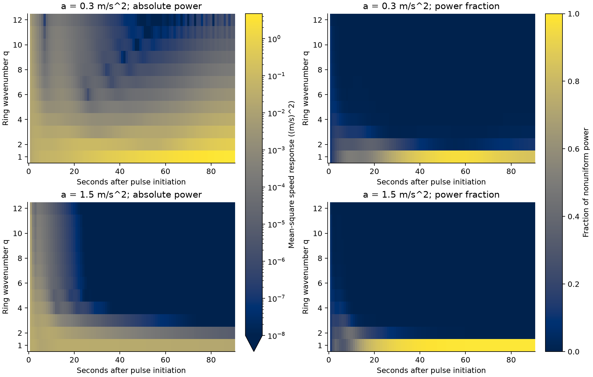

Figure 1. Instantaneous grouped power for the two prespecified responses. Absolute-power panels share a logarithmic scale; fractional panels share a linear scale. Uniform response is excluded. A dominant fractional mode can accompany decreasing absolute power.

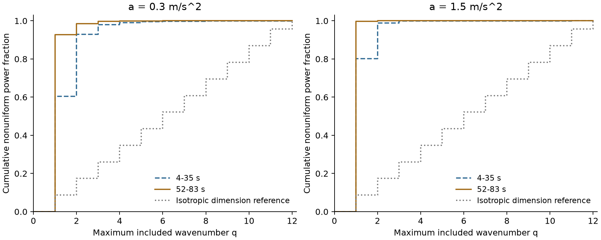

Figure 2. Cumulative integrated power versus maximum included wavenumber, with the dimension-weighted isotropic reference. The cumulative curves expose wavelength selection in both responses. Early and late powers use the fixed Hann windows.

### 3.2 Modal growth adds the distinction that normalized concentration omits

In the illustrated 0.3 m/s^2 response, q=1 has finite-window amplitude growth of +0.0299 s^-1, whereas q=12 has -0.0671 s^-1. The 1.5 m/s^2 response has negative reportable modal growth: q=1 gives -0.00299 s^-1, while q=2 gives -0.0522 s^-1. Higher-wavenumber power attenuates more quickly in that response, leaving a large relative contribution at q=1. Several late high-wavenumber powers fall below the reporting floor; their growth rates remain unreported.

The full grid shows which bands amplify and which attenuate under the selected headways and acceleration parameters. These finite-window measurements support a description of scale-dependent response. They do not establish an asymptotic stability boundary.

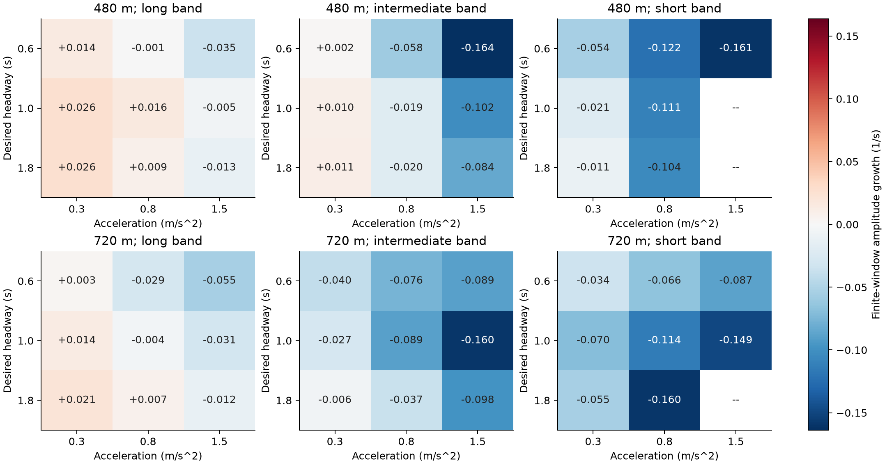

Figure 3. Mean finite-window band growth across the three placement seeds, at integration step 0.1 s. Positive values indicate amplification. Blank values marked with a dash fall below the power reporting floor. Ring lengths are nominal. The shared scale supports comparisons across panels.

### 3.3 Temporal density resolves the response across spatial and temporal scales

The joint density maps separate the low-wavenumber, low-temporal-frequency response from rapidly attenuating higher-wavenumber contributions. Integrating their frequency bins reproduces direct taper-weighted spatial power, with a maximum discrepancy of 5.56 x 10^-16 (m/s)^2 across the 172 existing responses. This identity validates the normalization. Total integrated power contains the same quadratic information as its time-domain counterpart.

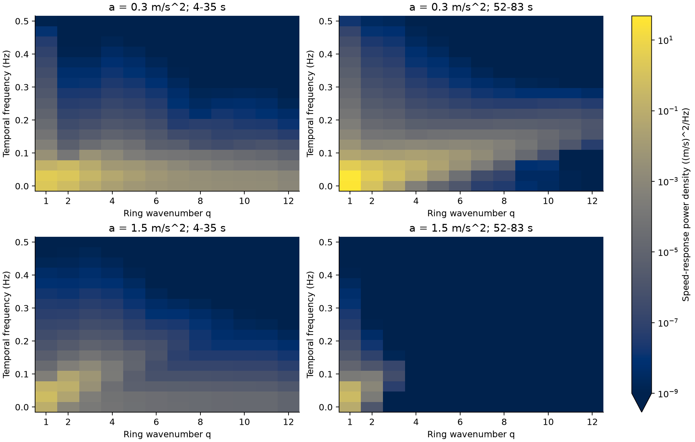

Figure 4. Grouped mode-frequency density in the early and late windows. All panels share one absolute logarithmic color scale, including the temporal zero-frequency bin. The broad low-frequency concentration and coarse bin spacing limit inference about individual oscillation frequencies.

The concentration result persists for the 24- and 40-sample windows: every primary grid response still has increasing long-band share. Constant temporal detrending also preserves the direction of this change, while reducing the minimum late share to about 0.754. Thus the exact concentration level depends on whether temporally slow modal response is retained.

### 3.4 Pulse strength changes power scaling, with a clearer linear limit for small pulses

Realized endpoint drops differ from their commands by at most 0.000350 m/s across both sweeps. In the larger-pulse sweep, early-window mean power exponents exceed 2 in all three acceleration settings. Smaller pulses move those exponents closer to 2. Normalized power therefore depends on the imposed disturbance over the larger amplitude range, including in the response that attenuates.

| Pulse range (m/s) | Acceleration (m/s^2) | Early exponent | Late exponent | Final exponent |
| --- | ---: | ---: | ---: | ---: |
| 0.5-2 | 0.3 | 2.903 | 3.093 | 0.289 |
| 0.5-2 | 0.8 | 2.636 | 2.693 | 1.172 |
| 0.5-2 | 1.5 | 2.477 | 2.512 | 2.508 |
| 0.05-0.2 | 0.3 | 2.088 | 2.101 | 1.433 |
| 0.05-0.2 | 0.8 | 2.059 | 2.062 | 2.026 |
| 0.05-0.2 | 1.5 | 2.044 | 2.046 | 2.046 |

Exponents are three-seed means at the finer integration step of each sweep. Full seed ranges are retained in the supporting tables. These values measure response scaling over finite amplitude ranges. They do not identify a universal power law.

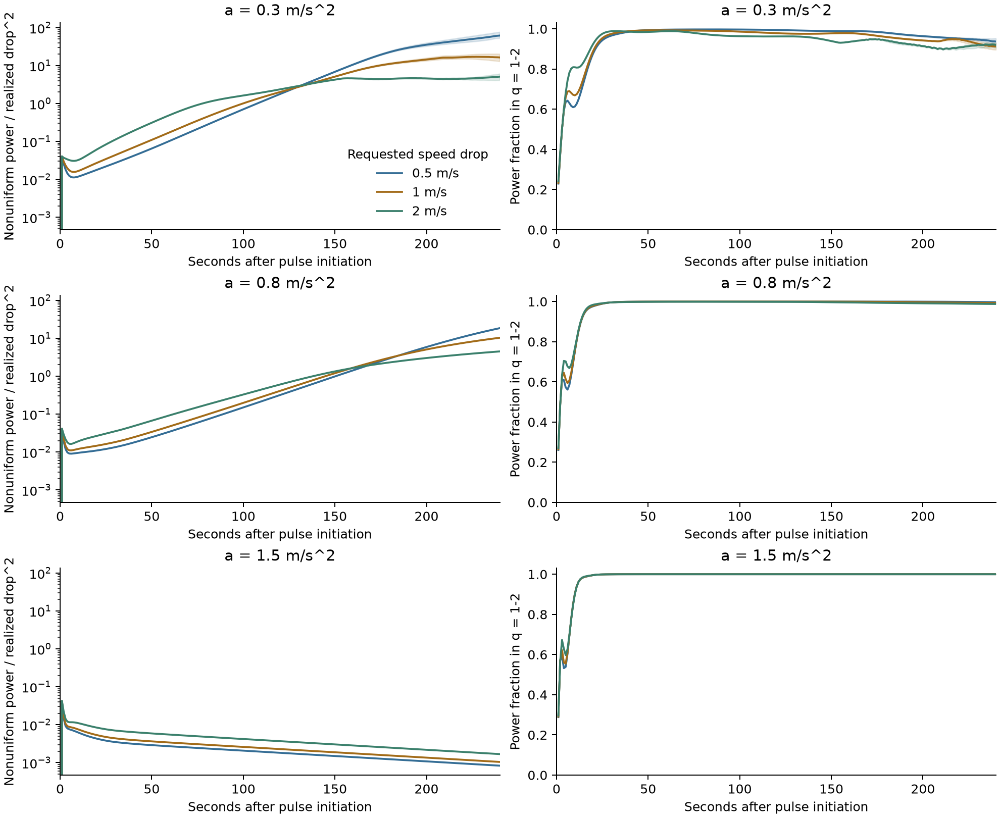

Figure 5. Larger-pulse sweep. Lines show the three-seed mean; shaded regions show the seed range. Left panels show D^2-normalized nonuniform power. Right panels show long-band power share. Each row fixes acceleration, headway, and ring length, so pulse strength varies separately. Integration step is 0.05 s.

At acceleration 0.3 m/s^2, final absolute powers for the larger pulses are much closer than their early powers: seed-mean final powers are approximately 12.44, 16.89, and 18.44 (m/s)^2 for requested drops of 0.5, 1, and 2 m/s. This compression produces the subquadratic final exponent. It is consistent with amplitude-dependent later evolution over the observation interval. A stable limiting oscillation or a specific saturation mechanism has not been identified.

The small-pulse sweep gives a more nearly amplitude-scaled early response. At acceleration 0.3 m/s^2, early normalized powers are approximately 0.01247, 0.01298, and 0.01408 for requested drops of 0.05, 0.1, and 0.2 m/s. Their final exponent still falls to 1.433. An early near-linear response can evolve into amplitude-sensitive behavior over a longer observation horizon.

### 3.5 Numerical validation and relation to forecasting

All 144 production simulator runs in the two pulse-strength sweeps retain all vehicles, produce finite records, and report zero collisions and teleports. Their paired pre-pulse responses are exactly zero. Default-run reproduction is bitwise exact. Refining the larger-pulse step changes integrated all-mode power by at most 0.0525 in absolute log ratio across the three windows; the smaller-pulse refinement gives at most 0.0353. These correspond to multiplicative differences below about 5.4% and 3.6%, respectively. They measure numerical sensitivity within the tested resolutions, without a convergence-order claim.

Three of the 54 grid step comparisons change growth/decay sign between 0.2 and 0.1 s. All are the nominal 480 m, headway 0.6 s, acceleration 0.8 m/s^2 setting: late/early power ratios are about 1.050 at 0.2 s and 0.934 at 0.1 s. None of the 32 additional parameter settings changes sign between 0.1 and 0.05 s. The primary counts therefore describe the stated numerical resolutions; near-boundary classification requires further refinement.

Grouped GFT and ordinary FFT power agree within 1.81 x 10^-14 (m/s)^2 over the 172 existing responses. Independent calculations using a full spatial FFT and explicit Hann weights verify the saved summaries through 6,878 numerical comparisons, with maximum absolute discrepancy below 1.37 x 10^-12. Hashes verify the recorded input arrays and frozen source archives. Complete repeated runs of both pulse sweeps reproduce all six numerical output tables byte for byte. The reproduction receipt records the software environment.

Earlier forecasting experiments on the 32 follow-up settings compared fixed complex Fourier AR(2), raw-coordinate VAR(2), dynamical-mode baselines, and recent amplitude trend. Fourier AR(2) had mean squared error 0.03206 for a future log-amplitude ratio, compared with 0.11387 for raw VAR(2) and 0.01486 for recent trend. These earlier outcomes motivated attention to explanation and measurement. The present descriptive study supplies no additional forecast evaluation or graph-specific accuracy claim.

### 3.6 The coupled dynamics predict small-amplitude responses

Every primary initial-condition case passes the 5% agreement criterion. The median full-field speed error over 20 s is 0.0899%, and the maximum is 1.617%. Finite-difference and analytic discrete Jacobians agree within 6.45 x 10^-11. Empirically estimated two-state transitions give growth rates within 0.000510 s^-1 and dominant-frequency magnitudes within 0.000091 Hz of the discrete prediction across both steps. These estimates use the first second of the paired gap/speed responses; they supply a local consistency check.

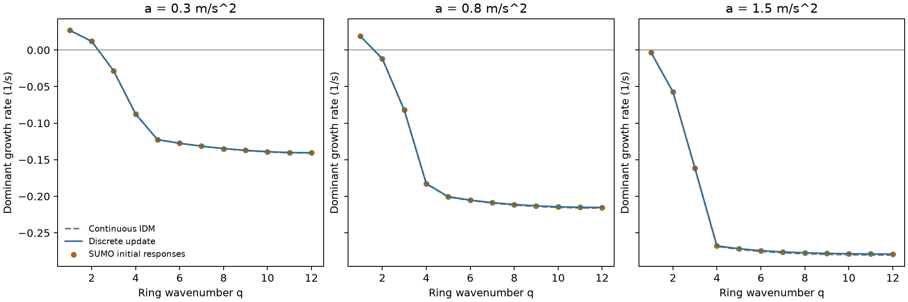

Figure 6. Continuous IDM, discrete-update prediction, and growth rates estimated from the initial SUMO responses. The complete gap-speed block supplies the growth rate. The GFT Laplacian eigenvalue orders spatial scale and is a separate quantity. Companion frequency and full-response-error figures appear in the development notes.

The result identifies a mechanism for the earlier scale selection. In the homogeneous equilibrium, low wavenumbers can grow or attenuate slowly while higher wavenumbers attenuate more quickly. Finite-time pulse responses still mix temporal branches and nonlinear contributions. Agreement near equilibrium does not make every finite-amplitude spectral growth statistic an intrinsic eigenvalue estimate.

### 3.7 A linearly decaying mode can carry growing harmonic power

Pure fundamental-mode initialization produces higher spatial harmonics. At the finer step, early-window power exponents are approximately 1.996-1.999 at q=1, 3.991-3.999 at q=2, and 5.986-5.998 at q=3 across acceleration settings. Those values are consistent with first-, second-, and third-order amplitude responses over the tested range. They describe a controlled weak-amplitude mechanism with finite windows.

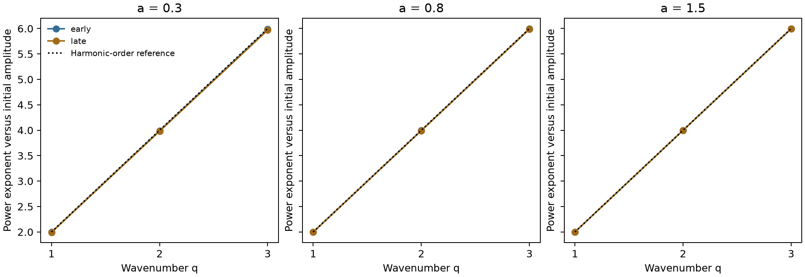

Figure 7a. Power exponents versus spatial harmonic order for a fundamental-mode initial speed disturbance. Early and late windows use the same four initial amplitudes where above the reporting floor. One late q=3 amplitude at acceleration 1.5 m/s^2 is below the floor at each step and is excluded; that exponent uses three amplitudes. Dotted values are the specified harmonic-order reference.

At acceleration 0.3 m/s^2, the continuous equilibrium q=3 growth rate is -0.02875 s^-1. Its observed harmonic amplitude-growth statistic is +0.1132 to +0.1150 s^-1 across the four initial amplitudes. At acceleration 0.8, the corresponding values are -0.08281 s^-1 and +0.0471 to +0.0479 s^-1. The discrete equilibrium q=3 modes also decay. An autonomous linear q=3 response initialized from the same recorded q=3 gap and speed remains far below the observed power. Initial harmonic seeding followed solely by a linear two-branch transient therefore fails to explain these responses. The amplitude-order and matched-state checks support subsequent nonlinear harmonic excitation. A nonlinear decomposition of the original localized-pulse responses remains to be done.

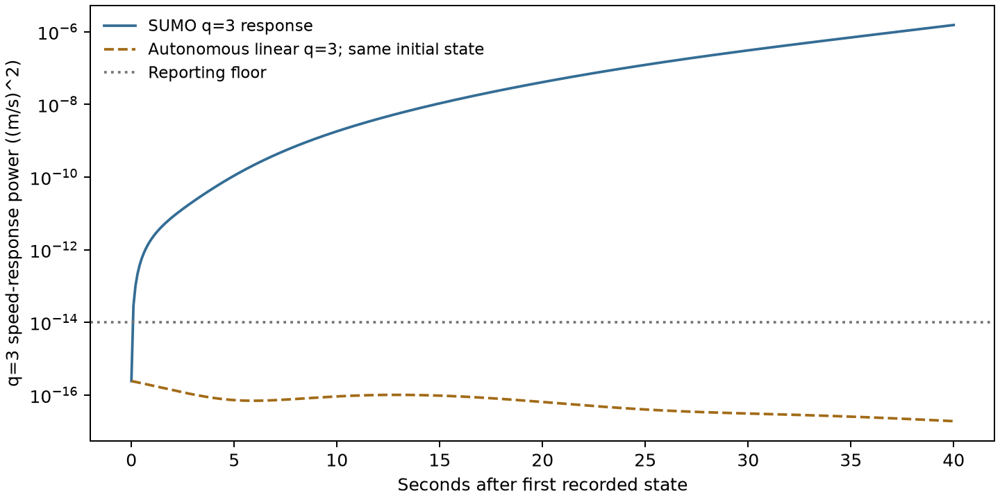

Figure 7b. Actual q=3 power and its autonomous linear prediction, initialized with the same observed q=3 gap and speed. The initial fundamental amplitude is 0.2 m/s, acceleration is 0.3 m/s^2, and integration step is 0.01 s. The reporting floor applies to measured response summaries; the deterministic model curve is shown below it for comparison.

### 3.8 Heterogeneity limits independent-band approximation

The full linear model retains small response errors under all four fixed driver patterns. Uniform graph bands remain exact for the homogeneous linear operator. Heterogeneity creates coupling between those bands, and removing that coupling produces much larger response errors.

| Headway pattern | Full operator | Uniform GFT bands | Weighted GFT bands | Fixed random bands |
| --- | ---: | ---: | ---: | ---: |
| Homogeneous | 0.453% | 0.453% | 0.453% | 80.47% |
| Alternating | 0.446% | 24.30% | 24.30% | 82.50% |
| Clustered | 0.462% | 32.04% | 21.55% | 79.93% |
| Fixed random | 0.453% | 16.42% | 15.67% | 81.12% |

Values are mean relative full-field speed-response errors over 20 s, across six initial disturbances at integration step 0.025 s. These are known-coefficient approximations with matched band dimensions. They are distinct from fitted predictive models.

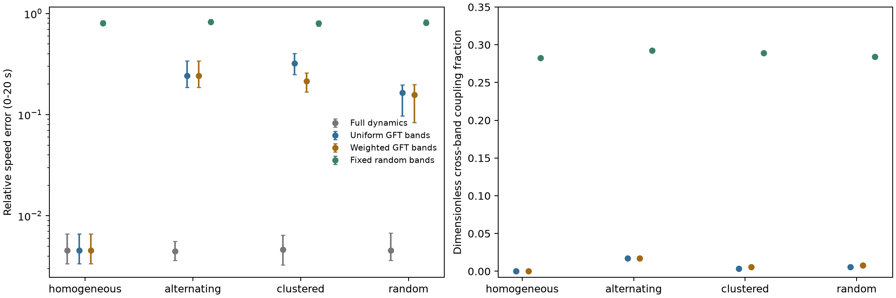

Figure 8. Mean response error and dimensionless coupling for the four headway patterns. Error whiskers span the six initial disturbances; they are not confidence intervals. The random comparison uses fixed seed 2000; the saved table includes all 20 random coupling references. Pattern names are categorical.

The weighted graph improves the clustered-pattern approximation but leaves a 21.55% mean error, compared with 0.462% for full dynamics. It also has a larger cross-band Frobenius coupling fraction than the uniform basis in that case, about 0.00549 versus 0.00359. The metric therefore fails to rank those finite-horizon errors. Alternating headways give constant edge weights under the chosen formula, so their two graph bases have equal response errors. The findings support retaining cross-band dynamics and testing the specific graph construction; they establish no general weighted-GFT advantage.

### 3.9 Empirical spectra depend strongly on baseline and spatial support

The acquired US-101 and I-80 blocks contain 212,427 and 226,638 rows, respectively. Selected keys are unique, selected fields have no missing values, and all positive within-vehicle increments are 0.1 s. Median position/speed discrepancies are about 0.040 and 0.032 m/s; maxima are 8.24 and 40.86 m/s. Four US-101 increments and 71 I-80 increments exceed 5 m/s discrepancy. Those observations are retained and flagged, with no automatic cleaning.

The primary US-101 grid has 13 complete 50 m bins over 650 m. Its integrated nonuniform power is 11.2595 (m/s)^2 with temporal means retained and 1.3671 after constant temporal centering. The first-two-mode share changes from 0.9554 to 0.6933 on the same support. These comparisons show the dependence of spectral concentration on the retained spatial speed profile and temporal baseline. Hann weighting means that the power difference is not an orthogonal partition of stationary-profile and fluctuation energy.

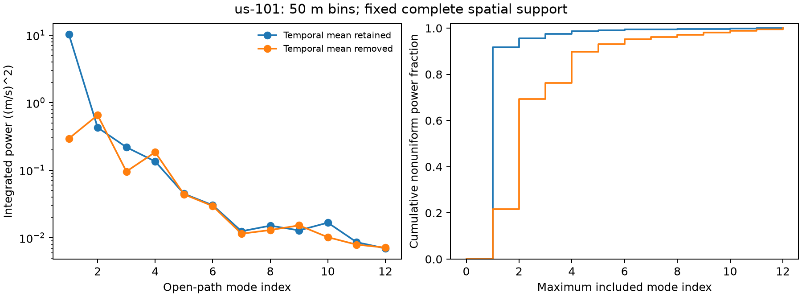

Figure 9. US-101 finite-window powers and cumulative shares before and after temporal centering, on fixed complete spatial support. Both absolute magnitude and normalized allocation change. The figures describe the selected processed recording, with no physical instability label.

I-80 fails the registered primary coverage rule: its longest complete 50 m strip has seven bins. The prespecified 25 m sensitivity has 13 bins over 325 m, with power 1.1515 before and 0.7357 after temporal centering; first-two-mode shares are 0.6939 and 0.6469. Its shorter spatial support and different recording prevent a direct instability comparison with US-101. The 100 m grids fail the eight-bin minimum at both sites. Every eligibility outcome remains recorded.

All eligible field calculations satisfy spectral integration checks and open-path GFT/cosine equivalence. These two short processed blocks establish measurement feasibility and baseline sensitivity. They provide no prospective forecast score or independent empirical instability classification.

The fixed-support resolution study has 20 eligible configurations among 32 specified combinations of location, quality rule, and bin sizes. I-80's 25 m field fails complete coverage at 1 and 2 s, with five and two missing cells respectively. Its 50 m configuration cannot exactly partition the fixed 325 m support. All US-101 configurations pass. These outcomes are retained separately from the initial primary-grid eligibility.

Across unfiltered US-101 bin choices, temporally centered nonuniform power ranges between 1.228 and 1.770 (m/s)^2; first-two-mode share ranges between 0.575 and 0.732. Excluding flagged traces removes four of 595 US-101 vehicles and 41 of 480 I-80 vehicles. At I-80's eligible 5 s by 25 m grid, that exclusion changes centered power from 0.7357 to 0.6926 (m/s)^2 and first-two-mode share from 0.6469 to 0.5549. These are measurement-population sensitivities within the same short recordings. They supply no independent physical change label.

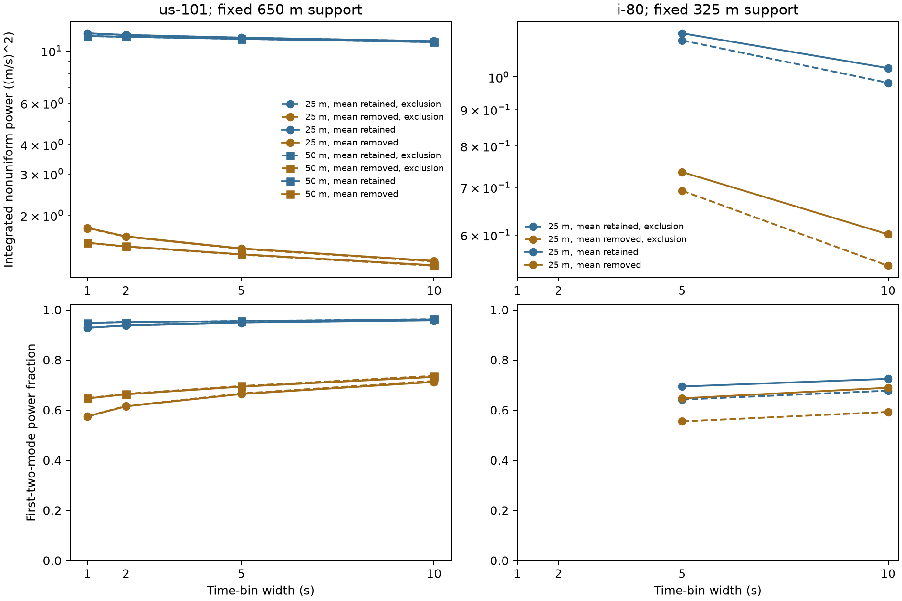

Figure 10. Retained and removed temporal means across eligible temporal/spatial bins. Solid lines use all observations; dashed lines exclude flagged vehicle traces. Markers distinguish 25 and 50 m bins. Power axes are logarithmic and have independent site ranges. Blank I-80 resolutions fail coverage. Lines connect the tested bin choices without implying results at intermediate widths.

### 3.10 Autonomous consistency depends on noise and observation geometry

With complete noiseless observations, both diagnostics accept every direct q=3 response and reject every fundamental-driven q=3 response across the tested phases, headways, and steps. Direct-mode acceptance includes the linearly growing q=3 control at headway 1.8 s. The distinction concerns agreement with autonomous dynamics, independent of the sign of those dynamics' growth rate.

The adjacent-innovation diagnostic has limited sensitivity once specified measurement noise is added. In the adaptive follow-up at headway 1 s and the lowest nonzero noise, its mean harmonic-response rejection frequency is 6.75%, compared with 52.25% for the whole-window fit. The latter spans 48-57% across the four phases, while its direct-gap and direct-speed controls give 5.5% and 5.75%. These values use the finer 0.01 s step and 100 noise histories per phase. At the next two noise levels, whole-window harmonic rejection falls to 8.25% and 6.5%. At headway 1.8 s it is 5.5% at the lowest nonzero noise. The diagnostic therefore has a limited detectable regime under its stated assumptions.

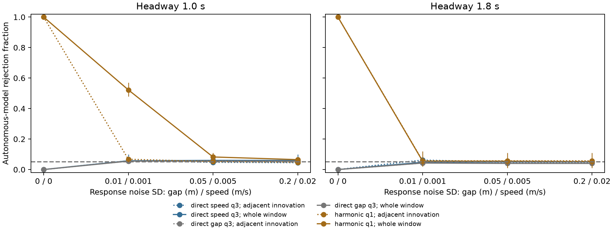

Figure 11. Complete-mask rejection frequency at integration step 0.01 s. Solid lines use whole-window fitting; dotted lines use adjacent innovations. Whiskers span four phase-specific frequencies and have no population-confidence interpretation. The dashed reference is the nominal 5% nonzero-noise null. Zero noise uses a separate 1% relative-residual criterion. Noise standard deviations apply to paired responses; real sensor errors are uncalibrated.

For the declared dictionary, q=3 remains identifiable with uniform-12 sensing despite two aliased nuisance directions. Uniform-8 sensing aliases q=11 with q=3 and requires abstention. Conditional recovery with uniform-12 and irregular-12 sensing reduces the low-noise, headway-1 whole-window harmonic rejection frequency to 23.75% and 10%, respectively. The alias controls also expose contamination by harmonics outside the declared dictionary. Sparse recovery therefore needs both an identifiability check and a justified spatial support model.

Independent physical-coordinate propagation, sensor-covariance calculations, and generalized least squares reproduce the diagnostic tables. Fresh exact-linear noise-null checks give whole-window rejection frequencies between 4.14% and 6.36%. A rejection tests the specified autonomous observation model; operator error, observation misspecification, or additional physical forcing can also cause rejection. The result supports a conditional model check without establishing a general nonlinear-mode classifier.

### 3.11 Correct IDM structure improves conditional calibration

The whole-window statistic is sensitive to modest parameter errors. At headway 1 s and the lowest noise, the finer-step mean rejection over direct gap/speed controls rises from 4.88% under the correct model to 43.13% when assumed acceleration is 5% too low, or 52.75% when assumed headway is 5% too low. These are direct-control model rejections; they establish no new physical instability.

Noise-aware unstructured fits reduce transition error relative to ordinary least squares, while their plug-in tests still over-reject direct-speed controls. Independent direct-response calibration lowers average control rejection and reduces harmonic sensitivity. Its pooled threshold also produces different gap/speed conditional rates. At the highest noise, 29 of the 320 operator cases are ineligible because of a non-positive corrected Gram matrix or an unidentified history design. Those cases remain separate from eligible diagnostic results.

The restricted fit changes this comparison. At headway 1 s and the lowest noise, its mean acceleration estimate is 0.30013 m/s^2, against the generating value 0.3. Mean relative operator error is about 0.023%, compared with 1.38% for TLS on the same training-noise realizations. The restricted plug-in test rejects 5.13% of direct-gap and 5.68% of direct-speed responses; TLS rejects 5.7% and 72.13%. With direct-response calibration, restricted-model harmonic rejection is 52.14%, compared with 9.23% for TLS and 52.19% for known dynamics. These values average the four new phases and 20 training-noise realizations. Restricted-model low-noise direct-control rates span approximately 4.85-6.09% across headways and initializations, leaving modest finite-estimation inflation.

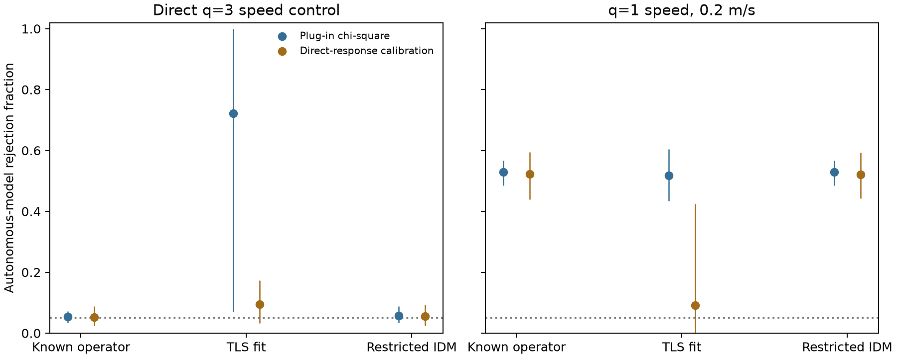

Figure 12. Adaptive evaluation cohort, headway 1 s, step 0.01 s, and response noise SD 0.01 m/0.001 m/s. Points are means across training-noise realizations; whiskers span their 20 phase-averaged frequencies. They are not population confidence intervals. The left panel measures direct-speed control rejection; the right measures rejection under fundamental-driven harmonic excitation. Restricted IDM uses the correct model and exact equilibrium information.

The larger 0.4 m/s fundamental is easier to distinguish. Under the restricted model at headway 1 s, direct-calibrated harmonic rejection is 100% at the lowest noise and 98.2% at the middle noise, falling to 8.99% at the highest noise. At headway 1.8 s, the corresponding middle-noise value is 9%. Detectability depends jointly on the physical response and observation assumptions. These controlled results establish neither a general learned-operator solution nor a practical warning rule.

Reference errors produce a further calibration limit. For the exact-linear, headway-1, finer-step null with independent measurement errors, ignoring the K=1 reference uncertainty raises false rejection to 81.18%; K=5 gives 30.52%. Correct joint covariance or constant/linear nuisance fitting gives 4.16-5.90% across the specified null scenarios. The correction has a sensitivity cost: in the corresponding exact-reference physical harmonic case, fitting offset and drift reduces rejection from 49% to 8.25%. Part of the weak finite-window signal can be represented by those nuisance terms. The supporting figures retain all correlation/reference configurations.

### 3.12 External input creates a spectral identification ambiguity

Continuous integration agrees with the matched SUMO speed responses within 0.642% at the coarser step and 0.256% at the finer step over 20 s. Refining the continuous solver changes full speed response by at most 8.92 x 10^-13 in relative norm, with gap conservation within 1.71 x 10^-13 m. These comparisons apply to the selected small-disturbance cases and numerical conventions.

Explicit q=3 acceleration forcing makes the autonomous diagnostic reject every low-noise response at both headways. Subtracting the known linear forced response lowers rejection to 9.5% at headway 1 s and 3.75% at 1.8 s. The former remains above the nominal noise-null rate, consistent with finite-amplitude mismatch of the linear companion. Autonomous-model rejection therefore needs an input interpretation as well as an operator interpretation.

The constructive linear control is stronger. Its q=3 growth rates are +0.01146 s^-1 for acceleration 0.3 and -0.08122 s^-1 for acceleration 1.5 at the same headway and equilibrium. An acceleration-only input with spatial amplitude below 0.00987 m/s^2 over the 40 s interval makes the decaying system reproduce the growing autonomous trajectory. Independently integrated states agree in relative norm within 1.18 x 10^-15 across all four phases. Their complex modal coefficients and powers agree to numerical precision. This is an unknown-input identifiability limit even with complete modal observations. Known forcing or additional physical constraints can distinguish the specified mechanisms.

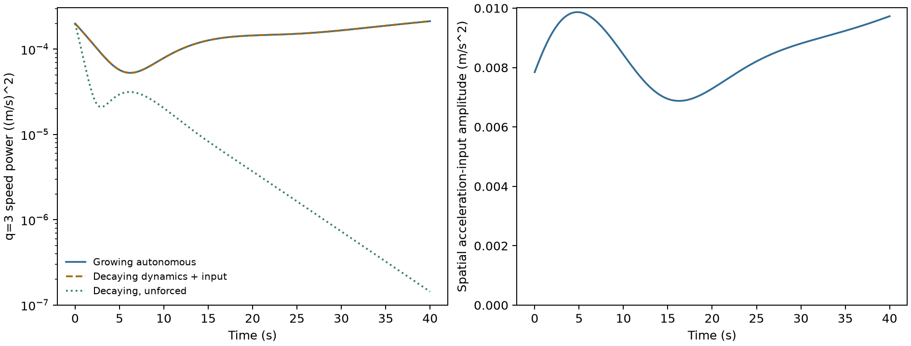

Figure 13. Exact linearized control at headway 1.8 s and the first new phase. Growing autonomous and decaying forced powers coincide. The decaying unforced response is shown separately. The right panel gives the prescribed spatial acceleration-input amplitude. The input is constructed in advance from the growing model trajectory; the figure describes a controlled equivalence, with no claim about unobserved inputs in the road recordings.

### 3.13 Measurement sensitivity persists across additional recording blocks

Four additional NGSIM blocks contain 906,559 rows, verified against separate server-side counts. New acquisition is 87.10 MB. Combined with the original two blocks, the six acquired cohorts contain 1,345,624 observations before spatial selection. All new unfiltered 5 s/25 m fields pass fixed-support coverage.

The expanded results retain substantial baseline sensitivity and show different share directions. In US-101's block beginning at 240 s, temporal centering changes power from 10.4338 to 1.7805 (m/s)^2 and first-two-mode share from 0.8948 to 0.5844. At I-80's corresponding block, power changes from 1.3252 to 1.1161, while share increases from 0.5703 to 0.6366. Temporal centering therefore changes modal allocation without a common share direction across these blocks.

The secondary exclusion flags 13 and seven US-101 vehicles, and 43 and 184 I-80 vehicles, in the two additional blocks per site. In I-80's block beginning at 420 s, excluding the 184 flagged traces removes 94,230 of 243,524 rows and leaves one empty field cell. That sensitivity is ineligible; the unfiltered field remains recorded. The rule has a substantial population and coverage effect in this block, without evidence that every excluded observation is erroneous.

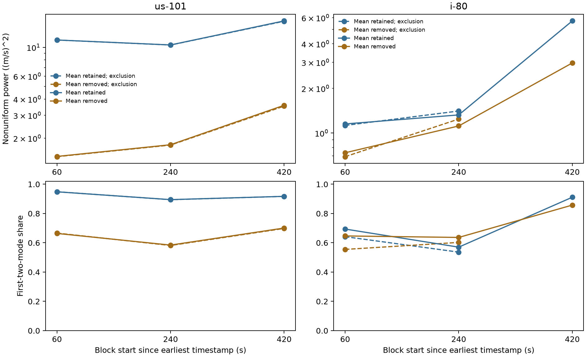

Figure 14. Three nonoverlapping blocks per site on unchanged 25 m spatial supports and 5 s temporal bins. Solid lines use all observations; dashed lines use trace exclusion. Power axes are logarithmic with independent site ranges. The final I-80 exclusion field fails coverage and has no plotted spectrum. Each block has its own periodogram and temporal mean. Lines connect the three tested blocks and provide no prospective trend estimate or independent-day uncertainty.

## 4. Discussion

The simulations support a distinction with practical consequences for spectral indicators. Long-wavelength concentration can increase because long modes amplify, because short modes attenuate faster, or through both processes. A rule that flags any increase in long-band share would flag all 54 primary grid responses despite their different absolute amplitude evolution. An operational warning rule would need prospective evaluation of absolute growth, current amplitude, and its own false-alarm rate.

The pulse experiments delimit interpretation of high power. Response magnitude depends on intervention strength and its recovery trajectory. Smaller pulses approach quadratic scaling in the early window, while larger pulses produce greater departures and later amplitude compression. The initial-condition follow-up supplies a separate mechanism check: a growing fundamental can generate increasing power in a linearly decaying harmonic. Assigning instability to a spatial mode therefore requires a dynamical model or a validated distinction between autonomous response and cross-mode excitation. The original pulse's command and recovery contributions have not been decomposed.

The graph representation has a clear scope. A regular cycle supplies the same spatial power decomposition as ordinary Fourier analysis. Its symmetric Laplacian orders spatial variation, while the car-following law has directed interactions and temporal memory. Graph eigenvalues therefore cannot be read as physical growth rates. Undirected eigenspace power also removes propagation direction. A signed ordinary Fourier companion is supplied in the supporting figures; converting its vehicle-index phase motion into road-frame wave speed requires positional data.

Several limitations constrain generalization. All simulations use IDM and a fixed-size ring. The first studies share parameters within each run; the heterogeneity follow-up introduces four specified headway patterns. Perturbations have known timing, are isolated, and have matched counterfactuals. The observation experiments add specified Gaussian noise and fixed masks to these paired responses. They assume exact references, known dynamics, local gap measurements, and known noise covariance. Driver patterns, initialization seeds, and numerical-step replicas supply limited variation. The large number of stored response records does not create an equivalent number of independent traffic environments.

Empirical growth and forecasting validation remain pending. The NGSIM examples demonstrate baseline sensitivity and retain trajectory inconsistencies. A previously audited I-24 virtual-trajectory sample also has unresolved generation parameters and online availability. Its upstream tool supports symmetric temporal smoothing, which can mix future observations into a timestamp. This issue matters for causal prediction and can alter measured spectral content. Documented preprocessing, adequate spatial support, and independent recording days are required before transferring the simulation-based instability interpretation to a real-road claim.

The whole-window test shows why retaining temporal structure can improve a model-consistency diagnostic over short-step innovations. The uncertainty studies identify conditions required for that interpretation. Unstructured transition estimation adds substantial uncertainty; the restricted IDM fit benefits from correct dynamics and exact equilibrium information. Reference corrections can control false rejection while absorbing weak signal. The exact forcing construction further shows that even complete modal observations can be compatible with different intrinsic stability when external input is unrestricted. A practical sensing study needs an input model, estimated baseline/noise treatment, and ordinary spatial or local-statistic controls under the same information budget.

The immediate generalization test is transfer under misspecified dynamics and equilibrium estimation. Correct-model success does not establish transfer to another driver model, a changing road geometry, or empirical trajectories. The longer NGSIM selection still covers only two recording contexts and lacks instability labels. A complete replication of the closest traffic spectral methods and a renewed priority check remain necessary before a publication novelty claim. The estimators and covariance corrections used here are established tools; the contribution under examination is the controlled interpretation and its limits.

## 5. Conclusion

Spectral power measurements describe the distribution and evolution of traffic disturbances across wavelengths. Increasing long-wavelength concentration occurs during both amplification and attenuation in the simulated rings. Positive mode-power growth can result from nonlinear harmonic generation or external input while the corresponding autonomous dynamics decay. Coupled gap-speed models support controlled consistency checks, whose calibration depends on model structure, noise, and reference treatment. Empirical examples retain substantial baseline, coverage, and trace-selection sensitivity across nonoverlapping blocks. Spectral indicators require those distinctions before they can support an instability interpretation. Empirical predictive validity and graph-specific benefit remain open.

## Data and Code Availability

The [experiment README](README.md) links protocols, run tables, and reproduction commands. [Initial spectral support](results/spectral/manuscript_support.json), [mechanism/empirical support](results/mechanism/manuscript_support.json), [observation validation](results/observation_window/independent_validation.json), and [uncertainty support](results/uncertainty/manuscript_support.json) record numerical evidence. Complete repeats reproduce the retained simulation tables byte for byte. Independent physical-coordinate projections, real-FFT calculations, and generalized least squares verify the extension outputs. The [uncertainty validation receipt](results/uncertainty/validation.json) distinguishes complete reproduction from its sampled diagnostic replay and independent fitted-matrix checks. [Clock](timing-correction.md) and [sampling-inverse](sampling-correction.md) corrections preserve superseded outputs and the sequence of analysis changes. Full simulator arrays and acquired trajectory inputs remain in the project's ignored data directory. Acquisition receipts retain source queries and hashes. The [development record](manuscript-notes.md) identifies unfinished work and reference-access limits. The existing public article is outside this manuscript's scope.

## References

1. Zhao, Nie, and Zhang (2014). [Extended spectral envelope method for detecting and analyzing traffic oscillations](https://doi.org/10.1016/j.trb.2013.12.007). Transportation Research Part B 61, 1-16.
2. Avila and Mezic (2020). [Data-driven analysis and forecasting of highway traffic dynamics](https://doi.org/10.1038/s41467-020-15582-5). Nature Communications.
3. Takada, Azuma, and Banno (2025). [Prediction of Traffic Congestion Using Graph Fourier Transform](https://doi.org/10.11509/sci.SCI25.0_1017). Proceedings of the Annual Conference of the Institute of Systems, Control and Information Engineers.
4. Loukas and Perraudin (2019). [Stationary time-vertex signal processing](https://arxiv.org/html/1611.00255v3). arXiv:1611.00255v3.
5. Treiber, Hennecke, and Helbing (2000). [Congested Traffic States in Empirical Observations and Microscopic Simulations](https://arxiv.org/abs/cond-mat/0002177). Physical Review E 62, 1805-1824. [DOI](https://doi.org/10.1103/PhysRevE.62.1805).
6. SciPy. [scipy.signal.periodogram documentation](https://docs.scipy.org/doc/scipy/reference/generated/scipy.signal.periodogram.html). Density scaling, windowing, and one-sided spectra.
7. Eclipse SUMO 1.28.0. [Pinned IDM implementation](https://github.com/eclipse-sumo/sumo/blob/v1_28_0/src/microsim/cfmodels/MSCFModel_IDM.cpp). Simulator source inspected for IDM iteration and update conventions; a local acquisition receipt retains its checksum.
8. U.S. Department of Transportation, Federal Highway Administration. [Next Generation Simulation Vehicle Trajectories and Supporting Data](https://data.transportation.gov/Automobiles/Next-Generation-Simulation-NGSIM-Vehicle-Trajector/8ect-6jqj). [Official metadata](https://data.transportation.gov/api/views/8ect-6jqj.json). Queried 15 October 2026; exact cohort queries and snapshots are recorded locally.
9. Dawson, Hemati, Williams, and Rowley (2016). [Characterizing and correcting for the effect of sensor noise in the dynamic mode decomposition](https://arxiv.org/html/1507.02264v3). [Published paper](https://doi.org/10.1007/s00348-016-2127-7). Noise bias, corrected moments, and total least squares.
10. Hemati, Rowley, Deem, and Cattafesta (2017). [De-biasing the dynamic mode decomposition for applied Koopman spectral analysis](https://arxiv.org/html/1502.03854v2). [Published paper](https://doi.org/10.1007/s00162-017-0432-2). Augmented-snapshot projection and estimator conditioning.
