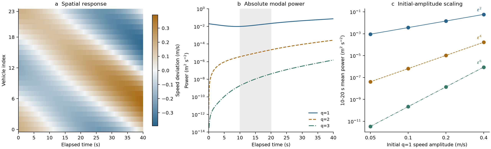
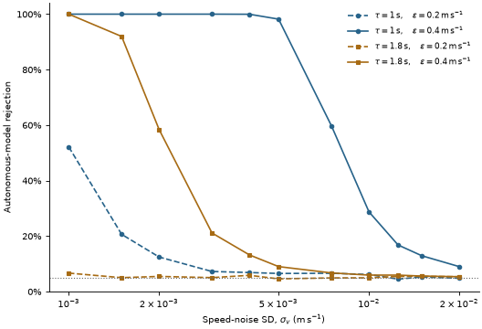
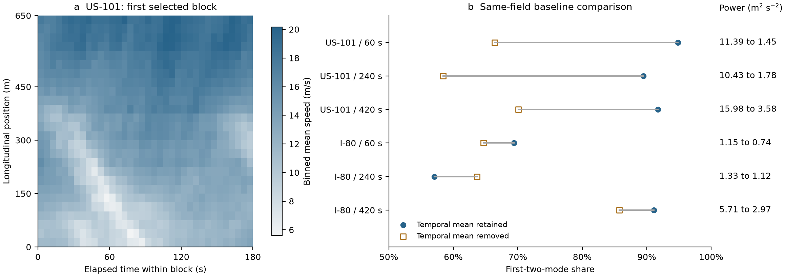

# Spectral growth and stability in simulated traffic

## Abstract

We examine whether the spatial spectrum of a traffic disturbance identifies its amplification or equilibrium stability. In paired Intelligent Driver Model simulations, long-wavelength power share increases in all 54 primary pulse responses, including 27 whose total nonuniform power decreases. Fundamental-mode initial conditions generate higher harmonics. Third-harmonic power grows in two settings where the corresponding equilibrium linear mode decays; amplitude scaling and a matched-state linear control support nonlinear harmonic excitation. A whole-window dynamical check distinguishes some of these responses under specified low noise. Its rejection rate depends strongly on operator estimation and reference treatment. A constructed acceleration input also makes a decaying linear modal subsystem reproduce a growing autonomous trajectory. Six NGSIM recording blocks illustrate baseline and coverage sensitivity, without empirical instability labels. The results provide controlled examples of ambiguity in spectral-growth interpretation. They establish no graph-specific forecasting advantage or operational warning method.

## 1. Research question

A spectral representation separates a spatial disturbance into wavelengths. We ask what an increase in one of those components identifies about the underlying dynamics. The distinction matters when a large or growing spectral coefficient is used as evidence of emerging congestion.

Traffic spectral envelopes, dynamical-mode analysis, and non-neural GFT congestion indicators already have published precedents [1-4]. Our experiments examine interpretation under controlled initial conditions, forcing, and observation errors. The study introduces no new spectral transform or estimator.

The forecasting experiments have not established improvement over the strongest tested baseline. In an earlier comparison on 32 additional SUMO parameter settings, a phase-aware Fourier AR(2) model has mean squared error 0.0321 for a future log-amplitude ratio; recent amplitude trend gives 0.0149. The regular vehicle cycle also has the same complete spectral subspaces as the ordinary discrete Fourier transform. These experiments supply no GFT-specific predictive gain. The present study therefore concentrates on physical interpretation and measurement limits.

## 2. Methods

### 2.1 Paired responses and spectral power

We use SUMO/libsumo 1.28.0 with its Intelligent Driver Model (IDM) implementation [5,7]. Each ring contains 24 vehicles. Desired speed is 30 m/s, vehicle length 5 m, minimum gap 2 m, and comfortable deceleration 2 m/s^2. Acceleration and desired headway vary by experiment. A pulse run is paired with an otherwise identical unperturbed control, giving the speed response

\[
x_i(t)=v_i^{\mathrm{pulse}}(t)-v_i^{\mathrm{control}}(t).
\]

This exact counterfactual is available in the simulator. Empirical measurements require a separately estimated reference.

After subtracting the spatial mean, we project onto complete eigenspaces of the equally weighted undirected cycle. For wavenumber q,

\[
E_q(t)=\frac{\|P_q[x(t)-\overline{x}(t)]\|^2}{24},\qquad
V(t)=\sum_{q=1}^{12}E_q(t),\qquad
S_{\mathrm{long}}(t)=\frac{E_1(t)+E_2(t)}{V(t)}.
\]

Power has units (m/s)^2 and describes a quadratic speed deviation. The Laplacian specifies spatial scale; it does not specify the directed car-following law. Grouping complete eigenspaces avoids dependence on arbitrary eigenvector orientations.

The primary pulse grid crosses nominal ring lengths 480/720 m, headways 0.6/1/1.8 s, and accelerations 0.3/0.8/1.5 m/s^2, with three small placement perturbations per setting. The primary integration step is 0.1 s. Earlier and later windows are 4-35 s and 52-83 s after a one-second slowdown command. Hann-weighted modal power is obtained by integrating one-sided temporal periodograms [6]. Integration equals the corresponding taper-weighted time-domain mean square; it adds a frequency allocation without adding independent total-power information. These transient spectra have no assumed stationary-process interpretation.

The 32 additional parameter settings use their finer 0.05 s step. Numerical-step replicas and placement perturbations are dependent observations. Full configurations, pulse-strength sensitivities, and reporting floors are in the [supplement](supplement.md).

### 2.2 Equilibrium dynamics and harmonic controls

For homogeneous equilibrium, let s be gap, v speed, and let vehicle i+1 lead vehicle i. With IDM acceleration derivatives F_s, F_v, and F_l, the gap-speed evolution of spatial mode q is

\[
B_q=\begin{pmatrix}0&e^{ik}-1\\F_s&F_v+F_l e^{ik}\end{pmatrix},\qquad k=2\pi q/24.
\]

Both temporal branches contribute to the speed response. We derive the corresponding discrete SUMO update and check it against a full physical-coordinate Jacobian and finite differences. Seventy-two primary small-amplitude cases excite individual wavelengths through gap or speed perturbations. Predictions start at the first recorded state and retain the complete two-state dynamics.

The harmonic study fixes nominal ring length 480 m and headway 1 s. Initial speed perturbations contain q=1 only, with amplitudes 0.05/0.1/0.2/0.4 m/s. Acceleration is 0.3/0.8/1.5 m/s^2. Steps 0.025/0.01 s give 24 responses, recorded every 0.1 s through 40 s. We measure q=1,2,3 power in half-open 10-20 s and 20-30 s windows. Descriptive log-power slopes test amplitude orders two, four, and six. A matched autonomous q=3 prediction starts with the actual first recorded q=3 gap and speed. It tests whether initial harmonic seeding followed by linear evolution explains the later response.

### 2.3 Observation and model checks

For q=3, a whole-window check fits an unknown initial four-dimensional real gap-speed state to 41 observations over 10-30 s at 0.5 s spacing. Given transition M and observation covariance, generalized least squares projects onto the trajectory design I,M,...,M^40. With the exact linear Gaussian model, the residual sum of squares has 160 degrees of freedom. A 95th-percentile cutoff tests that specified model. Rejection can arise through forcing, nonlinear response, or model and observation errors.

Direct q=3 controls start at gap amplitude 0.02 m or speed amplitude 0.02 m/s. Fundamental-only speed amplitudes are 0.2 or 0.4 m/s. Noise is added to paired responses with gap/speed SDs (0.01 m,0.001 m/s), (0.05 m,0.005 m/s), or (0.2 m,0.02 m/s). These scenarios are uncalibrated to real sensors. An adaptive follow-up evaluates the restricted fit at 11 specified speed-noise SDs between 0.001 and 0.02 m/s, with gap-noise SDs in meters ten times those numbers. The operator and calibration cutoff are estimated anew at each level. Training uses direct q=3 responses over 0-10 s; a separate phase cohort supplies direct-response calibration; further cohorts supply evaluation. Operator fits include total least squares (TLS), known-noise corrected moments [9,10], and a restricted IDM fit. The restricted fit uses exact equilibrium and the correct IDM form to infer headway, then estimates acceleration by whole-history variable projection.

This comparison changes prior information, parameter count, and fitting objective together. It does not isolate a causal benefit of physics constraints over an otherwise matched estimator. Phase increments within each homogeneous-ring cohort are vehicle-index translations for the tested modes. They supply symmetry-related trajectories. Twenty training-noise realizations and 100 evaluation-noise draws per trajectory measure conditional noise sensitivity, without creating independent traffic environments.

Reference sensitivities add time-shared errors estimated from K=1 or 5 independent reference measurements, optionally with linear drift, and temporal AR(1) errors. We compare an iid/exact-reference analysis, correct joint covariance, and fitting constant/linear reference terms. The latter retains 152 residual degrees of freedom. The [supplement](supplement.md) reports observation masks, abstentions, and additional operator comparisons.

### 2.4 Trajectory measurements

The NGSIM analysis uses three nonoverlapping 180 s blocks at each of US-101 and I-80, beginning 60/240/420 s after the location's earliest dataset timestamp [8]. Cohorts contain 1,345,624 trajectory rows before spatial selection. API counts and hashes verify acquisition. They cover two recording contexts and supply no independent-day replication.

We average observed speeds across all lanes in 5 s/25 m cells on fixed supports of 650 m at US-101 and 325 m at I-80. Every cell must contain data. An open-path transform, equivalent to a cosine transform, analyzes the spatially demeaned field. Comparisons retain or remove each spatial coefficient's temporal mean on identical support. A secondary exclusion removes an entire selected trace if any position/speed discrepancy exceeds 5 m/s. That rule changes the population; it is not a certified correction of trajectory errors. Raw observations remain unchanged.

## 3. Results

### 3.1 Concentration does not determine absolute growth

Long-wavelength share increases in all 54 primary grid responses. Total nonuniform power increases in 27 and decreases in 27. The same distinction occurs in the 32 additional finer-step settings: all shares increase, with 19 growing and 13 decaying responses. A rule that flags any increase in long-wavelength share therefore does not separate those outcomes.

For example, at nominal length 480 m, headway 1 s, and placement seed 31, acceleration 0.3 m/s^2 gives an early-to-late power ratio of about 11.5, while acceleration 1.5 gives about 0.60. Their long-wavelength shares rise from 92.96% to 98.50% and from 98.93% to nearly 100%, respectively. Preferential attenuation of shorter modes can leave a concentrated spectrum while absolute power falls.

### 3.2 A decaying equilibrium mode carries growing harmonic power

The coupled linear model passes the specified 5% full-field speed-error criterion in all 72 primary small-amplitude cases. Median relative error over 20 s is 0.090%, and maximum error is 1.62%. This supports using the equilibrium mode blocks as a local reference for the subsequent harmonic experiment.

Fundamental-only initial disturbances produce higher spatial harmonics (Figure 1). At the finer step, early-window power exponents span 1.996-1.999 for q=1, 3.991-3.999 for q=2, and 5.986-5.998 for q=3 across acceleration settings. These are finite-range response slopes, with four amplitudes per early-window fit.

At acceleration 0.3 m/s^2, q=3 has equilibrium growth rate -0.02875 s^-1. Its measured finite-window harmonic amplitude-growth statistic is +0.1132 to +0.1150 s^-1. At acceleration 0.8, the corresponding values are -0.08281 s^-1 and +0.0471 to +0.0479 s^-1. Both discrete equilibrium modes also decay. Matched-state autonomous q=3 predictions account for less than 1.1 x 10^-9 of late measured power in these settings.

Initial harmonic seeding plus a linear transient consequently fails to explain the result. The controlled initial condition and amplitude scaling support nonlinear spatial harmonic excitation. They do not identify a unique coupling path, a conserved-energy transfer, or the mechanism of the original localized-pulse response.

Figure 1. Nominal 480 m ring, headway 1 s, acceleration 0.3 m/s^2, step 0.01 s. (a) Spatially demeaned paired speed response after q=1 initialization at 0.2 m/s. (b) Absolute q=1,2,3 power in the same response; values below the numerical 10^-14 (m/s)^2 reporting floor are omitted. The shaded interval supplies the early window. (c) Mean power in that window for all four initial amplitudes. Points are simulated values; lines are integer-order references anchored at the smallest amplitude. These deterministic amplitude comparisons provide no population confidence interval.

### 3.3 Model checking has a restricted detectable regime

At headway 1 s and the lowest specified noise, the known-operator whole-window check rejects 52.25% of fundamental-driven q=3 histories, compared with 6.75% for adjacent innovations. Direct q=3 gap/speed controls give 5.5% and 5.75% rejection under the whole-window check. These frequencies concern the particular amplitudes, observation model, and fixed physical trajectories.

Estimation changes the result. Table 1 compares methods on the adaptive evaluation cohort. TLS gives high direct-speed rejection with its plug-in threshold. Calibration against the pooled direct-response mixture lowers that rate and reduces harmonic sensitivity. Its calibrated gap/speed rates, 0.46% and 9.44%, average to 4.95% and conceal a subgroup imbalance. The restricted fit remains closer to the known-model comparison. Its correct IDM law, exact equilibrium information, and whole-history objective are substantial assumptions.

| Model | Threshold | Direct-gap rejection | Direct-speed rejection | Harmonic rejection, 0.2 m/s |
| --- | --- | ---: | ---: | ---: |
| Known dynamics | Plug-in | 5.14% | 5.31% | 52.98% |
| Known dynamics | Direct calibration | 5.05% | 5.20% | 52.19% |
| TLS | Plug-in | 5.70% | 72.13% | 51.71% |
| TLS | Direct calibration | 0.46% | 9.44% | 9.23% |
| Restricted IDM | Plug-in | 5.13% | 5.68% | 53.00% |
| Restricted IDM | Direct calibration | 5.00% | 5.60% | 52.14% |

Table 1. Headway 1 s, step 0.01 s, gap/speed noise SD 0.01 m/0.001 m/s. Each cell averages four symmetry-related phase trajectories and 20 training-noise realizations, with 100 evaluation draws per trajectory. A high rejection rate is undesirable for direct controls. The harmonic column measures rejection under known nonlinear excitation. These are conditional frequencies, without independent-road accuracy or coverage interpretation. Pooled calibration need not calibrate either control subgroup at 5%.

The amplitude/noise comparison in Figure 2 shows the limited operating range. At headway 1 s and fundamental amplitude 0.4 m/s, restricted-fit rejection decreases from 98.2% at speed-noise SD 0.005 m/s to 59.74% at 0.0075 m/s and 28.74% at 0.01 m/s. At headway 1.8 s, the same amplitude gives 58.39% rejection at 0.002 m/s and 9% at 0.005 m/s. At the smaller amplitude, 0.2 m/s, headway 1 s gives only 6.53% rejection at 0.005 m/s. Direct-gap/speed controls span 4.36-6.30% rejection across the 11-level sweep. These conditional rates describe a strong dependence on disturbance amplitude and headway.

Reference treatment adds a separate tradeoff. In one exact-linear null, ignoring K=1 reference uncertainty gives 81.18% false rejection. Correct joint covariance and fitted reference terms give 4.16-5.90% across the specified null scenarios. In the corresponding exact-reference physical harmonic case, fitting constant and linear terms reduces rejection from 49% to 8.25%. Those nuisance terms can absorb weak finite-window response. Neither exact-noise calibration nor correct-model fitting establishes reliability when noise and equilibrium must themselves be estimated.

| | |
| --- | --- |
|  | **Figure 2.** Restricted-IDM rejection across 11 noise levels. Tau: headway; epsilon: initial speed amplitude. Dotted line: 5% reference. |

### 3.4 The empirical fields test measurement choices

All six unfiltered 5 s/25 m fields pass the fixed-support rule. Temporal centering substantially changes their powers and modal shares (Figure 3). In US-101's block beginning at 240 s, first-two-mode share falls from 89.48% to 58.44%. In I-80's corresponding block, it rises from 57.03% to 63.66%. The direction depends on the retained spatial profile and time variation. Hann weighting means that the power difference is not an orthogonal partition of profile and fluctuation energy.

Trace exclusion is consequential. In I-80's block beginning at 420 s, it removes 184 of 539 traces and 94,230 of 243,524 acquired rows (38.69%). Inside the analyzed support, it removes 69,874 of 155,366 observations (44.97%), leaving one empty cell. That sensitivity is ineligible and receives no imputed spectrum. The initial primary I-80 50 m grid also failed its eight-bin requirement; the later 25 m sensitivities do not replace that failure.

These results describe baseline, population, and coverage dependence. Binned observation speeds are not traffic density or flow measurements. The fields have no independent instability labels or established causal availability, and therefore provide no empirical validation of the simulator's stability interpretation.

Figure 3. (a) The first US-101 block, using 5 s/25 m observation averages. (b) First-two-mode shares before and after temporal centering on the same six fields. Row labels give location and block start after the earliest dataset timestamp. Text at right reports integrated nonuniform power with the mean retained and removed. US-101 and I-80 supports are 650 and 325 m; identical mode indices describe different spatial wavelengths across sites. Comparisons are within each row. No uncertainty across independent days is available.

## 4. Interpretation and limits

The most substantive controlled finding is growing harmonic power in a mode whose equilibrium linear dynamics decay. Spectral concentration alone also fails to identify amplification in the tested rings. Both results require measuring absolute response and specifying the evolution law. The transform makes scale-specific behavior easier to describe. On the regular cycle it is an ordinary Fourier representation, and the full orthogonal transform preserves the input information.

Unknown external input creates an additional algebraic ambiguity. For two modal blocks B_g and B_d with the same gap-kinematics row, choose a trajectory satisfying dz/dt=B_g z and prescribe

\[
u(t)=(B_g-B_d)z(t).
\]

Then dz/dt=B_d z+u(t) produces the same trajectory. Our q=3 linearizations at headway 1.8 s have intrinsic rates +0.01146 and -0.08122 s^-1. The constructed acceleration-only input stays below 0.00987 m/s^2 over 40 s, and independent integration reproduces the coefficients to numerical precision. This is a direct consequence of the state equation for one modal subsystem. It supplies no evidence about full-system stability or the occurrence of these inputs in the road recordings.

The observation studies provide a conditional diagnostic benchmark. Correct-model restriction, noise-aware fitting, and reference treatment are useful comparisons, but their separate contributions have not been isolated. The exact equilibrium used by the restricted fit determines headway under the assumed IDM law. Estimation on unknown driver laws, uncertain equilibria, realistic sensor errors, and constrained or measured forcing remains untested.

All physical simulations use one driver model and small rings. Placement perturbations, translated initial waves, and numerical-step replicas provide limited variation. The empirical blocks share two recording contexts. Large row counts, repeated Gaussian draws, and reproducible calculations do not supply independent environments or an event prevalence for operational alerts.

Transfer to measured traffic remains an open test. It requires independently labeled disturbance episodes, verified observation availability, and comparisons with local amplitude trends and established traffic spectral methods. The current evidence supports controlled interpretation tests and measurement cautions.

## Reproducibility

The [supplement](supplement.md) records secondary experiments and numerical checks. The [research review](review-2026-11-06.md) ranks claims and documents figure selection. [Protocols and commands](reproduction.md) link frozen configurations, complete tables, source snapshots, and raw-file hashes. Independent calculations and complete repeat runs are distinguished in the validation receipts. Raw acquired trajectories and full simulation arrays remain local under ignored `data/`; manuscript figure inputs are exported alongside their source hashes. No historical experiment output was changed by this presentation review.

## References

1. Zhao, Nie, and Zhang (2014). [Extended spectral envelope method for detecting and analyzing traffic oscillations](https://doi.org/10.1016/j.trb.2013.12.007).
2. Avila and Mezic (2020). [Data-driven analysis and forecasting of highway traffic dynamics](https://doi.org/10.1038/s41467-020-15582-5).
3. Takada, Azuma, and Banno (2025). [Prediction of Traffic Congestion Using Graph Fourier Transform](https://doi.org/10.11509/sci.SCI25.0_1017).
4. Loukas and Perraudin (2019 manuscript). [Stationary time-vertex signal processing](https://arxiv.org/html/1611.00255v3).
5. Treiber, Hennecke, and Helbing (2000). [Congested Traffic States in Empirical Observations and Microscopic Simulations](https://arxiv.org/abs/cond-mat/0002177).
6. SciPy. [Periodogram normalization and conventions](https://docs.scipy.org/doc/scipy/reference/generated/scipy.signal.periodogram.html).
7. Eclipse SUMO 1.28.0. [Pinned IDM implementation](https://github.com/eclipse-sumo/sumo/blob/v1_28_0/src/microsim/cfmodels/MSCFModel_IDM.cpp).
8. FHWA. [NGSIM trajectories and official metadata](https://data.transportation.gov/api/views/8ect-6jqj.json). Acquisition queries and hashes are retained in the experiment results.
9. Dawson, Hemati, Williams, and Rowley (2016). [Characterizing and correcting for the effect of sensor noise in DMD](https://arxiv.org/html/1507.02264v3).
10. Hemati, Rowley, Deem, and Cattafesta (2017). [De-biasing DMD for applied Koopman spectral analysis](https://arxiv.org/html/1502.03854v2).
